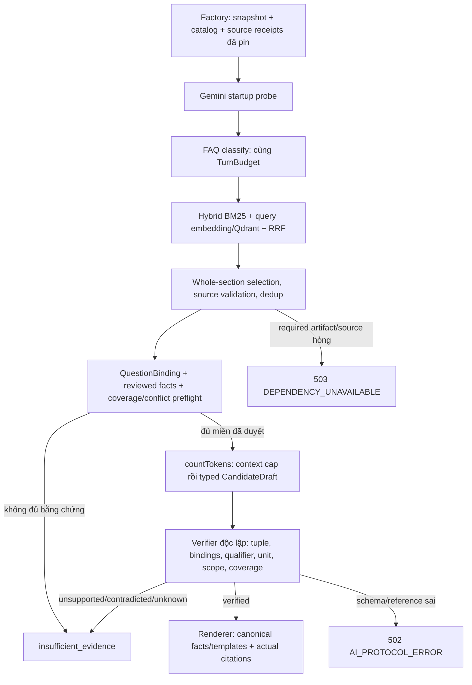

# Phase 3 — Grounded Generation

Contract vận hành cho FAQ hiện tại; checklist, kết quả chạy và acceptance ở
[PROCESS](PROCESS.md#phase-3--grounded-generation). Kế thừa typed contract D1.19 trong
[architecture](architecture.md#d119--contract-cho-semantic-verification-gate-chỉ-đặc-tả).
Không có corpus/catalog production được duyệt hoặc Gemini run mới trong Phase 3.

## Đường chạy thực tế



`app/main.py` gọi `load_verification_gate` trước tạo/probe generation provider và truyền gate
vào `Faq`. `Faq._run` từ chối thiếu gate trước classify, kể cả host/test injection. Mọi FAQ
đi qua `verified_faq_answer` → `VerificationGate.prepare` → `final_payload` → renderer khi
verified. Không còn nhánh release `GroundedAnswer.supported=true` hoặc fallback v2→v1.
Capability-unavailable giữ template code cũ, không tạo hotel fact/citation.

Default `AI_RETRIEVAL_MODE=hybrid`; explicit `bm25` giữ index legacy nhưng vẫn bắt buộc gate.
Settings default không chứng minh cấu hình process đang chạy; không sửa `.env` trong nhiệm vụ.
Public envelope, Spring và React không đổi; FAQ vẫn tối đa ba evidence/citations,
4000 UTF-16 units, empty cards/actions/toolCalls. Không có business tools/booking mới.

## Artifacts và trust boundary

Có **hai publications pin độc lập**, không lấy catalog.source làm source truth duy nhất:

- Catalog JSON theo `CatalogData` (`d1-catalog-1`), gồm vocabulary/rules/templates, facts,
  source versions, reviewed chunk hashes, complete review declarations và approvals.
- Source receipts JSON theo `SourceReceipts`: `schemaVersion=grounding-sources-1`, `mode`,
  `snapshotId`, `sources` (1–256 `Source` records đúng schema D1.19 và approval riêng).

Loader yêu cầu cả paths + SHA-256 + authority allowlist do operator cấu hình; chỉ đọc dưới
`.local/grounding/<mode>/`, chặn symlinks/path escape, file quá 256 KiB, duplicate JSON keys,
hash/schema/cross-reference sai. `.local/grounding/` được ignore. Không có default facts,
fallback catalog, auto-approval hay code import fixture vào `app/`.

Source reader đọc lại manifest/index và Markdown allowlist thật, đối chiếu raw file SHA,
document/source version/ref, snapshot, mode và validity với receipts. Nguồn phải được duyệt
trong cả metadata ingestion và receipts; approval authority/hash phải hợp lệ. Production
không chấp nhận demo fixture/synthetic source. Catalog, fact, template và authority integrity
được kiểm tra ở `VerifiedCatalog`; source/catalog drift trước release là dependency error.

SHA pin xác nhận bytes và người triển khai đã chọn đúng artifact. Nó không là chữ ký số
hay bằng chứng người duyệt hiểu đúng nội dung; publisher/configuration là trusted boundary.

## Quy trình review/publication

1. Người phụ trách duyệt tài liệu khách sạn thật: ID/version/ref, ngày hiệu lực, điều kiện và
   ngoại lệ. Không đổi `approved=false` chỉ để service ready. Giữ demo ở mode riêng.
2. Build paired index theo [INGESTION](INGESTION.md); pin release/snapshot. Các bước gọi
   embedding thật chỉ chạy khi được cho phép riêng, không thuộc lần kiểm chứng offline này.
3. Reviewer lập atomic facts/vocabulary/rules/templates từ **toàn section** của release.
   Mỗi binding gắn đúng source/chunk IDs, hashes và spans. Kiểm tra phủ định, đơn vị, khoảng
   thời gian, ngoại lệ và các nguồn mâu thuẫn. Model không cấp approval.
4. Reviewer độc lập so source → fact → template và question aliases. Chỉ ghi complete review
   khi đã rà đầy đủ scope/conflicts; hash đúng không thay bước này. Approvals D1.19 pin
   `review_hash` của source/fact/catalog; fact hash bao gồm vocabulary và renderer được duyệt.
5. Publisher tin cậy ghi catalog và receipts thành **file immutable version mới** trong
   `.local/grounding/<mode>/`; tính SHA-256 của bytes UTF-8 chính xác cho từng file. Không ghi đè
   release đang phục vụ. Chuẩn bị đủ hai file trước khi đổi cấu hình/restart; pin mismatch
   trong chuyển đổi giữ not-ready, không phục vụ partial publication.
6. Cấu hình `AI_GROUNDING` và chạy validator offline dưới đây. Chỉ khi artifact validation,
   review chất lượng và các gate phát hành được chấp nhận mới vận hành/probe service thật.

Hiện chưa có publisher workflow/UI hoàn chỉnh, chữ ký/phân quyền phê duyệt, người duyệt
độc lập hoặc catalog/corpus production. Runbook mô tả yêu cầu publication; validator chỉ
kiểm tra artifact được cung cấp, không tự tạo/duyệt fact. Đây vẫn là blocker production.

Ví dụ **cấu hình placeholder**, không phải artifact có sẵn:

```powershell
$env:AI_GROUNDING='{"catalog_path":".local/grounding/production/<release>/catalog.json","catalog_sha256":"<64-lowercase-hex>","sources_path":".local/grounding/production/<release>/sources.json","sources_sha256":"<64-lowercase-hex>","authorities":["<approved-authority>"],"context_input_tokens":6000,"max_evidence":3}'
.\.venv\Scripts\python.exe -B -m app.orchestration.verification.artifacts
```

Validator không gọi Gemini/Qdrant API, không build/rewrite artifacts, không tự approve;
exit 0 khi local source/catalog/receipts hợp lệ, exit 1 và fixed dependency code nếu thiếu/sai.
Qdrant readiness và Gemini availability vẫn cần kiểm chứng riêng, validator không chứng minh.
Giữ credential trong môi trường server, không đặt vào catalog/prompt/client/log.

## Context, budget và generation

Assembly nhận ranked evidence của Phase 2, giữ nguyên whole sections và toàn metadata,
exact-dedup theo citation ID, reject duplicate ID khác payload. Chọn tối đa `max_evidence`
(1–3) theo rank, không rewrite/truncate excerpt, không tự bổ sung missing fact. RRF loại
metadata ineligible trước khi được vote; score không chứng minh support. Unreviewed passage
có thể được selection nhận nhưng preflight chặn **trước answer generation**.

`context_input_tokens` cấu hình 1–8000, default 6000, là cap **toàn answer input** gồm system,
schema, message/query, evidence và offered facts; không chỉ riêng excerpt. Adapter Gemini
hiện có `countTokens` xác minh trước `generateContent`, `TurnBudget.reserve/record` kiểm
cap cả token count dự kiến và usage thực nhận. Nếu whole-section context không vừa, trả
`BUDGET_EXCEEDED`; không cắt scope/ngoại lệ để cố trả lời. Không thêm tokenization/model call.
Đây là reject-over-budget, chưa có thuật toán chọn lại sections theo token count.

Giữ generation model, timeout và tổng budget: 20 giây từ Spring, 8000 input/2000 output,
tối đa hai generation (classify + answer), một retrieval, không retry. Retrieval embedding
HTTP nằm trong cùng deadline nhưng generation usage không bao gồm embedding cost. Local
validation/checksum còn synchronous, có budget checks trước/sau; chưa có scale/CPU SLO proof.

Prompt `d1-verified-faq-1` chỉ yêu cầu proposal `d1-claim-proposal-2`, không answer prose,
không supported vote. Raw CandidateDraft từ chối duplicate JSON keys ở mọi nesting level trước typed parsing, để không âm thầm bỏ extra claims. Offered facts chỉ là facts có provenance thực trong retrieved slice
và thuộc QuestionBinding; required keys do host bind từ original message sau redaction.

## Những gì gate xác minh được

- Structural: strict schemas, actual turn registry/source/chunk/version/ref/hash/spans,
  offered fact IDs và binding/citation pairs, catalog/source approval/validity và mode.
- Closed semantic consistency: exact typed value/unit/time scope/qualifiers, đủ mọi required
  fact, không release partial support, single-valued contradictions trong reviewed slice.
- Release: renderer chỉ dùng canonical values và reviewed data-only templates. Grant được
  host cấp cho đúng turn, không nhận từ model, dùng một lần; kiểm tra drift trước phát hành.

Unknown/ambiguous alias, unsupported, contradicted, unreviewed slice, thiếu required evidence
hoặc coverage đều abstain. Alias matching là full-message NFC/casefold/whitespace, không
regex đoán ý, bỏ phủ định hoặc dùng classifier rewrite làm nguồn QuestionBinding.

**Không xác minh deterministic được:** reviewer hiểu sai prose, facts chưa được trích đầy đủ,
question paraphrases ngoài vocabulary, contradiction chưa được review trong nguồn khác,
hoặc free-form entailment tổng quát. G20 deliberately duyệt sai fact nhưng giữ source phủ
định: gate có thể release sai. Giới hạn này phải xuất hiện trong evaluation, không đổi gold
để gọi semantic acceptance PASS. Chưa có LLM judge hay inference engine cho prose mở.

## Error contract

| Input/outcome | Public result |
| --- | --- |
| Verified, đủ mọi claim | 200 answered, canonical answer và citations từ actual registry |
| Empty/unknown/unsupported/contradicted/partial coverage/model abstains | 200 insufficient_evidence, fixed refusal, citations=[] |
| Citation/binding pair hợp lệ toàn cục nhưng thuộc fact khác | 200 insufficient_evidence, không thay citation giúp model |
| Extra prose/supported/claim, missing refs, unknown citation hoặc pair sai source | 502 AI_PROTOCOL_ERROR, không final |
| Required source/catalog/receipts missing, stale, revoked hoặc hash drift | 503 DEPENDENCY_UNAVAILABLE, dependency latch theo hiện hành |
| Hết input/call/output/context budget | 503 BUDGET_EXCEEDED, không latch dependency |
| Shared deadline hết | 504 DEADLINE_EXCEEDED; cancel propagate, không retry |
| Unexpected verifier/renderer exception | 500 INTERNAL_ERROR qua boundary, không chuyển thành abstention |

## Test mapping cho 24 yêu cầu Phase 3

| Yêu cầu | Bằng chứng offline |
| --- | --- |
| 1–6,8: valid/empty/duplicate/unapproved/expired/mode/provenance | `test_grounding_context.py`, `test_grounding_artifacts.py`, factory tests |
| 7: context cap, boundary và actual usage | `test_grounded_factory.py`, Gemini REST countTokens parser/dispatch thật với MockTransport |
| 9–11: supported/unsupported/contradicted | `test_verification_gate.py`, `test_grounding_evaluation.py`, factory tests |
| 12–14: wrong source/chunk/valid pair wrong fact | gate provenance tests, adapter wrong chunkId/sectionId trước answer dispatch, evaluation wrong-source-pair/valid-pair-wrong-content |
| 15–17: supported=true/missing citation/malformed schema | factory legacy/missing/extra/reference/duplicate-claims, raw CandidateDraft JSON và gate tests |
| 18–20: dependency/partial coverage/empty with eager model | catalog drift/source-revoked, missing-second-claim, empty-model-ready và factory empty cases |
| 21–24: factory/gate/no bypass/errors/regression | `test_grounded_factory.py`, `test_hybrid_qdrant.py`, FAQ runtime/deadline/readiness/collector regression |

Evaluation standalone: `python -B -m tests.evaluation.evaluate_grounding --output .local/paired-index/phase3-evaluation.json`. Dữ liệu mới ở `tests/fixtures/grounding/gold.json`;
không sửa D1.15 hoặc Phase 2 gold. Synthetic evaluation dùng fake retrieval/generation;
factory integration kiểm tra orchestration và REST parser riêng, Docker test kiểm tra native
async Qdrant path. Không suy fake-provider quality là Gemini quality. Kết quả/denominators,
fault injection rates, G20 và acceptance ở [EVALUATION](EVALUATION.md#phase-3--offline-grounded-generation).

Collector D1 đọc được legacy v1 records, ghi CandidateDraft/input fields/prompt version mới
và pin source-map mới. CLI live yêu cầu configured gate trước tạo provider; direct offline
tests inject reviewed test gate tường minh. Không chạy collector/live trong Phase 3; không
re-score hay sửa artifacts lịch sử, không coi dataset D1 cũ đã có review catalog mới.
