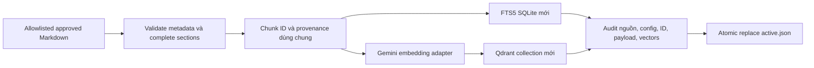

# Phase 1 — nền tảng ingestion, embedding và vector indexing

Phạm vi: pipeline **offline** có thể tái tạo và kiểm chứng cho cặp SQLite FTS5–Qdrant.
Đây là mốc Phase 1; Phase 2 hiện đã bổ sung [Hybrid Retrieval opt-in](HYBRID.md) mà không sửa
snapshot/artifacts Phase 1. Các câu “chưa triển khai” dưới đây mô tả phạm vi tại mốc Phase 1.
Đường FAQ D1 vẫn dùng `KnowledgeIndex`/snapshot cũ; Phase 1 chưa nối vector search vào chat,
chưa có Hybrid Retrieval/RRF, reranking, context assembly mới hoặc thay Gemini generation.
Trạng thái và kết quả kiểm thử nằm ở [PROCESS](PROCESS.md#phase-1--nền-tảng-dữ-liệu-hybrid-rag).

## Quyết định triển khai

1. Tái sử dụng allowlist `SOURCES`, parser/approval/date checks và chuẩn hóa text của
   [snapshot.py](../app/ingestion/snapshot.py). Giữ nguyên format và dữ liệu snapshot D1.
2. [documents.py](../app/ingestion/documents.py) kiểm tra bổ sung duplicate YAML keys,
   document/chunk identity, người duyệt, ngày duyệt production, symlink và kích thước.
3. [Embedding adapter](../app/providers/embeddings.py) dùng HTTPX REST có sẵn;
   [Qdrant adapter](../app/providers/qdrant.py) dùng HTTPX REST, không cần thêm SDK.
4. [PairedIndex](../app/ingestion/vector_pipeline.py) xây cặp FTS5/Qdrant mới, audit rồi
   kích hoạt bằng **một con trỏ local**. Không cần transaction phân tán hoặc alias remote.



## Nguồn và chunking

- Production dùng bốn đường dẫn knowledge hiện có trong allowlist; không glob repository,
  đọc MySQL, crawl URL, nạp README/AGENTS hoặc nhận upload. Toàn bộ nguồn thật hiện vẫn là
  bản nháp chưa duyệt: pipeline từ chối, không tự sửa approval/ngày hiệu lực.
- Demo chỉ dùng `tests/fixtures/d1/faq.md` có `synthetic=true`. Mode có thư mục và collection
  riêng; production từ chối cờ synthetic và nguồn `synthetic:`. Tests dùng root tạm,
  không xuất fixture vào production index của workspace.
- Tài liệu theo YAML front matter và các heading `## SECTION-ID ...` hiện có. Mỗi section
  là một chunk atomic, giữ nested headings, list, table, thời gian, điều kiện và ngoại lệ.
  Phần trước section đầu tiên được lặp trong **mọi chunk** để giữ phạm vi áp dụng chung.
- `max_characters` mặc định 2000, cấu hình 200–2000. Chunk quá lớn bị từ chối, không cắt
  câu hay bỏ phần cuối. Người biên tập cần tách thành các section độc lập đầy đủ điều kiện.
  `overlap=0` vì không chia section; phần dẫn nhập đã được giữ tường minh.
- Reject toàn build nếu thiếu/rỗng/không hợp lệ, source ID trùng, section ID trùng,
  nội dung chunk hoàn toàn trùng, hoặc body section trùng trong một document. Không âm thầm
  bỏ bản ghi và báo index hoàn chỉnh. Chưa có fuzzy dedup cho tài liệu gần giống nhau.

Mỗi chunk giữ `source_id` (= document ID), `chunk_id`, `content`, `document_type` (= category),
`title`, `document_version`, `section_id`, `source_ref`, `source_path`, `source_checksum`,
`content_checksum`, `corpus_mode`, `approved`, `approved_by`, `approved_at`,
`effective_from`, `effective_to`. Ngày duyệt được chuẩn hóa về date; checksum giữ raw bytes.

Chunk ID là SHA-256 của document ID, version, section ID và **toàn bộ content được index**.
Qdrant point ID là UUIDv5 xác định từ chunk ID; payload vẫn giữ nguyên SHA-256 chunk ID.
FTS5 lưu cùng chunk payload. Qdrant thêm `snapshot_id` để ràng buộc release. Chunk ID mới
có thể khác D1 vì có thêm document preamble; không sửa citations/artifacts D1 lịch sử.

## Embedding và cấu hình

Cấu hình tập trung tại [indexing.py](../app/indexing.py), độc lập `GEMINI_MODEL` generation.
Mặc định `gemini-embedding-001`, REST `v1beta`, 768 dimensions; profile cho phép 768/1536/3072.
001 dùng `RETRIEVAL_DOCUMENT` cùng title khi index và `RETRIEVAL_QUERY` khi encode query.
Profile `gemini-embedding-2` cũng được hỗ trợ cho text: document dùng `title: … | text: …`,
query dùng `task: search result | query: …`; không gửi `taskType` của 001 cho model 2.
Hai model có embedding spaces khác nhau, bắt buộc re-embed khi đổi model.
Đối chiếu [Gemini embeddings guide](https://ai.google.dev/gemini-api/docs/embeddings) và
[REST API](https://ai.google.dev/api/embeddings); chỉ kiểm chứng contract bằng HTTP giả lập,
chưa gọi Gemini thật trong Phase 1.

Vector được kiểm tra đúng dimension, numeric/finite, nonzero và chuẩn hóa L2 bằng stdlib;
Qdrant dùng Cosine. Không biến score thành độ tin cậy hoặc tỷ lệ đúng. Không cắt text để
né token limit. Limit của model 001 là 2048 input tokens; giới hạn ký tự không phải token
count. Nếu provider từ chối input, build lỗi và không publish. Chưa có embedding token meter.

PowerShell, từ `ai-service`:

```powershell
$env:AI_EMBEDDING='{"model":"gemini-embedding-001","dimension":768,"revision":"001"}'
$env:AI_CHUNKING='{"max_characters":2000}'
$env:AI_QDRANT_URL='http://127.0.0.1:6333'
```

`GEMINI_API_KEY` giữ ngoài Git, được dùng riêng cho embedding adapter. Có thể đặt
`AI_QDRANT_API_KEY` và `AI_INDEX_HTTP_TIMEOUT` (mặc định 30 giây cho mỗi HTTP operation).
HTTP không TLS chỉ được phép trên loopback; client không theo redirect, không tự retry,
không đọc proxy environment. Không ghi key, request/response body hoặc raw exception vào lỗi.
`revision` là nhãn do operator quản lý; model name không chứng minh weights bất biến và
pipeline không phát hiện được provider âm thầm đổi weights dưới cùng model name.

## Docker, ingestion và truy vấn

Qdrant v1.17.0 được pin cả tag và image digest trong [compose.qdrant.yaml](../compose.qdrant.yaml),
REST bind loopback, storage là Docker named volume. Không dùng volume của database/booking.

```powershell
docker compose -f compose.qdrant.yaml up -d
docker compose -f compose.qdrant.yaml ps
```

Nếu cổng 6333 đã có dịch vụ, chọn `AI_QDRANT_PORT` khác cho Compose và cập nhật
`AI_QDRANT_URL` tương ứng; không dừng dịch vụ đang có. Qdrant REST collection/query dựa trên
[collections](https://qdrant.tech/documentation/manage-data/collections/) và
[quickstart](https://qdrant.tech/documentation/quickstart/) chính thức.

Lệnh sau **gọi embedding API thật**, chỉ chạy khi operator cho phép và đã cấu hình key:

```powershell
.\.venv\Scripts\python.exe -B -m app.ingestion.vector_cli rebuild --mode demo_synthetic --allow-embedding-api
```

Production dùng cùng command với `--mode production`, chỉ sau khi tất cả nguồn đã được
khách sạn duyệt và có ngày hiệu lực/ngày duyệt hợp lệ. Không có option bật fake trong CLI.
Không truyền `--allow-embedding-api` sẽ lỗi trước dispatch. Phase 1 không thực hiện command
gọi API thật này; pipeline end-to-end đã chạy trong tests với fake embedding và Docker Qdrant thật.

Kiểm tra index active hoặc truy vấn riêng từng store, không gọi model:

```powershell
.\.venv\Scripts\python.exe -B -m app.ingestion.vector_cli status --mode demo_synthetic
.\.venv\Scripts\python.exe -B -m app.ingestion.vector_cli lexical --mode demo_synthetic --query 'hành lý'
.\.venv\Scripts\python.exe -B -m app.ingestion.vector_cli search --mode demo_synthetic --vector-file query-vector.json --category faq --source-id demo-faq
```

`query-vector.json` chứa JSON array vector đã encode bằng **đúng model/profile** active.
API vector không thể suy ra model đã tạo một array từ chính các số; operator phải bảo đảm
nguồn query vector. Đây là primitive similarity search cho Phase 1, chưa có chat query encoder
hoặc kết hợp lexical/vector. `status` audit đầy đủ, không chỉ kiểm tra Qdrant process sống.

## Lifecycle và phục hồi

Output riêng, đã ignore: `.local/paired-index/<mode>/<runId>/index.sqlite`, `manifest.json`
và `.local/paired-index/<mode>/active.json`. Không ghi vào `.local/assistant-index` D1.

1. Writer lấy exclusive `.build.lock` theo mode. Writer thứ hai lỗi rõ ràng.
2. Validate nguồn; fingerprint chứa source checksums, chunk IDs, chunking và toàn embedding
   profile (provider/model/API/dimension/tasks/normalization/input recipe/revision).
3. Tạo SQLite staged; embed từng chunk; tạo collection vật lý mới có UUID. Không overwrite
   collection cũ, kể cả rebuild cùng input. Fingerprint/identity tái lập; run ID khác nhau.
4. Upsert `wait=true`; scroll toàn collection và so point ID, chunk/source payload, dimension,
   giá trị vector round-trip; đối chiếu SQLite. Đọc lại nguồn để phát hiện đổi giữa build.
5. Ghi manifest với checksums của SQLite và vectors; rename thư mục hoàn chỉnh. Ghi/fsync
   pointer tạm rồi `os.replace` trên cùng filesystem. Reader đọc pointer một lần để chọn
   đúng SQLite **và collection vật lý**; không đọc alias Qdrant độc lập.
6. Lỗi trước publish giữ pointer/collection active cũ; cleanup collection candidate best effort.
   Nếu cleanup thất bại, lỗi có `cleanup_pending=true`. Không báo thành công giả.

`active()` kiểm tra lại nguồn/hiệu lực, config, manifest, SQLite và toàn inventory Qdrant.
Nguồn đổi hoặc bị thu hồi làm index cũ không được dùng, dù collection vẫn còn. Rebuild nguồn
mới hợp lệ để phục hồi. Config/model/dimension đổi phải rebuild; không trộn không gian vector.
Việc kiểm tra/copy đồng bộ toàn index phù hợp corpus nhỏ và chỉ ở đường offline Phase 1.

Process crash có thể để lại lock, thư mục staged/orphan hoặc collection chưa publish. Xác minh
PID/process thật và không có writer đang chạy trước khi operator xóa lock; không suy process
đã chết chỉ từ file lock. Giữ active pointer và mọi release đang được reader dùng. Không tự
GC collection/snapshot cũ hoặc xóa Docker volume. `docker compose … down` giữ volume;
không dùng `down -v` nếu cần giữ dữ liệu. Chưa có command GC/rollback tự động.

Atomic publication không phải distributed durability/HA: cần filesystem local hỗ trợ atomic
replace; chưa kiểm thử mất điện hoặc Qdrant mất storage. Mỗi active audit từ chối dữ liệu
không đồng bộ. Một host điều phối/đọc pointer; shared/distributed deployment thuộc phạm vi khác.

## Kiểm thử và Phase 2

```powershell
.\.venv\Scripts\python.exe -B -m pytest -q -p no:cacheprovider tests/unit tests/integration
$env:PBL6_QDRANT_DOCKER='1'
.\.venv\Scripts\python.exe -B -m pytest -q -p no:cacheprovider tests/integration/test_qdrant_indexing.py
```

Default suite không gọi mạng/cloud; Docker suite chỉ mở đúng cổng loopback của container test
riêng trên port ngẫu nhiên, fake embedding, nguồn/root tạm và tự stop container sau tests.
Không cần Gemini key cho regression. Evidence/acceptance chi tiết ở [EVALUATION](EVALUATION.md#phase-1--test-matrix-ingestionembeddingqdrant).

Hướng tiếp theo tại mốc Phase 1 là query embedding, fusion/filtering và FAQ adapter; phần đó
đã được triển khai ở [Phase 2](HYBRID.md). Context assembly mở rộng, production gold, Gemini
quality và reranking còn cần giao/đánh giá riêng; không tự mở business tools hoặc semantic gate.
