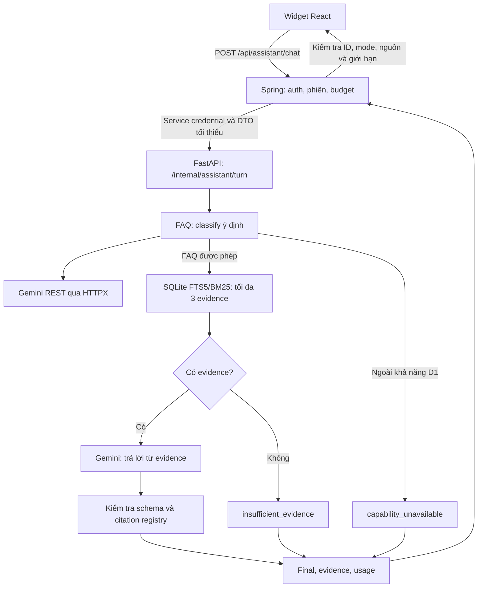
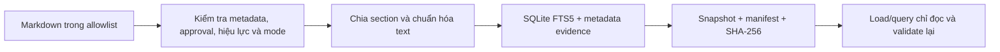
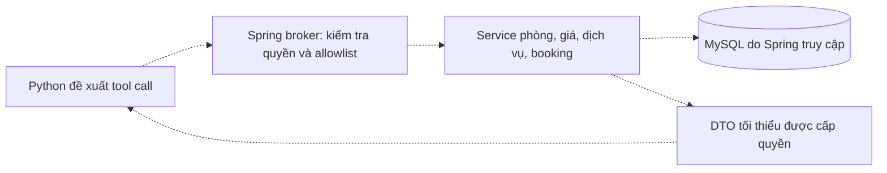

# Kiến trúc trợ lý khách sạn

Cập nhật: **2026-11-19**, đối chiếu implementation tại baseline `e1ec7c8`. Tiến độ và bằng chứng nghiệm thu được quản lý trong [PROCESS.md](PROCESS.md).

**Đang sử dụng: RAG với luồng điều phối cố định cho FAQ**, tích hợp React/Vite → Spring Boot → Python/FastAPI → Gemini REST và SQLite FTS5/BM25. Đã có provider, ingestion, retrieval, Spring facade và widget opt-in. Business tool broker, booking và vòng agent nhiều bước vẫn thuộc D2–D4. D1 đã chạy với Gemini thật nhưng chưa đóng nghiệm thu độ ổn định/grounding; production chưa có corpus được duyệt.

## Phân chia trách nhiệm hiện tại

| Thành phần | Vai trò đã có | Điểm vào/source |
| --- | --- | --- |
| React/Vite | Widget góc dưới bên phải, gửi chat/reset tới Spring, hiện nguồn/nhãn demo, hủy request và bỏ phản hồi muộn khi đổi account | [AssistantWidget.jsx](../../FE/src/components/assistant/AssistantWidget.jsx), [api.js](../../FE/src/services/api.js) |
| Spring Boot | Xác thực guest/member, ràng buộc phiên/owner, idempotency/TTL, budget, kiểm tra response/evidence/citation từ Python | [AssistantController.java](../../BE/src/main/java/com/example/pbl6/controller/assistant/AssistantController.java), [AssistantSessions.java](../../BE/src/main/java/com/example/pbl6/service/assistant/AssistantSessions.java), [AssistantClient.java](../../BE/src/main/java/com/example/pbl6/service/assistant/AssistantClient.java) |
| FastAPI | API nội bộ với service auth, validation/body cap/request ID, lifecycle và health/readiness | [main.py](../app/main.py), [boundary.py](../app/api/boundary.py) |
| FAQ orchestration | Classify ý định, một retrieval, tổng hợp câu trả lời từ evidence và kiểm tra citation registry | [faq.py](../app/orchestration/faq.py) |
| Gemini adapter | REST countTokens/generateContent qua HTTPX; structured JSON, kiểm tra schema/usage, budget và lỗi | [gemini.py](../app/providers/gemini.py), [contracts.py](../app/providers/contracts.py) |
| Ingestion/retrieval | Build snapshot Markdown offline, FTS5/BM25, metadata/checksum/approval/hiệu lực, trả tối đa ba evidence | [snapshot.py](../app/ingestion/snapshot.py), [index.py](../app/retrieval/index.py) |
| Diagnostics | Events tổng hợp và timing HTTP theo request; bỏ dữ liệu nhạy cảm, queue timing có giới hạn | [diagnostics.py](../app/diagnostics.py), [http_timing.py](../app/providers/http_timing.py) |

Python runtime dùng FastAPI/Uvicorn, Pydantic/Pydantic Settings, HTTPX và PyYAML; SQLite FTS5 có sẵn trong môi trường đã kiểm tra. Phiên bản khóa trong [requirements.lock](../requirements.lock). Chưa dùng LangChain, SDK Gemini, embedding model, vector database, Redis hoặc nền tảng Azure trong đường chạy này.

## Luồng online D1 đã triển khai



1. Browser dùng API Spring; JWT khách/cookie chỉ phục vụ xác thực và phiên tại Spring. Python nhận token service riêng, message/history đã giới hạn, context, allowedTools và budget; không nhận principal/JWT của khách.
2. Python kiểm tra snapshot rồi tạo budget cho turn. Classifier Gemini trả intent và query; message/history được làm sạch một số mẫu credential/contact trước gửi model. Đây là lọc theo mẫu, không là bảo đảm loại bỏ mọi PII tự do người dùng nhập.
3. Nếu intent là FAQ và được phép `search_knowledge`, truy vấn lexical trên snapshot bằng FTS5/BM25. Không có evidence thì trả `insufficient_evidence`. Câu cần chức năng chưa hỗ trợ trả `capability_unavailable`.
4. Khi có evidence, Gemini tạo answer và citation IDs. Runtime từ chối citation rỗng/trùng/ngoài evidence registry. Kiểm tra này xác nhận danh tính nguồn trong lượt, chưa tự chấm được việc mọi claim đều được nguồn hỗ trợ.
5. Python trả final/evidence/usage; Spring kiểm tra contract, ID, corpus mode, citation và budget, từ chối business tool calls. UI hiển thị text an toàn, nguồn và nhãn synthetic khi áp dụng.
6. `DELETE /api/assistant/session` reset phiên tại Spring. Resume nội bộ trả `409 CONTINUATION_NOT_FOUND`; chưa có continuation hoặc vòng tool nghiệp vụ.

Budget của đường Spring hiện tại là tối đa 20 giây tích lũy, 8000 input/2000 output tokens, một retrieval, tối đa hai generation. Mỗi generation gọi countTokens trước generateContent, nên một turn có thể có tối đa bốn HTTP calls provider; không retry. Validate index ban đầu diễn ra trước budget, các thao tác index còn đồng bộ, vì vậy không xem đây là bảo đảm wall-clock tuyệt đối cho toàn request.

## Luồng offline và nguồn kiến thức



- Ingestion chạy offline bằng module `app.ingestion.snapshot`, không tự build khi startup và không crawl/upload URL do khách cung cấp.
- Snapshot nằm ở `.local/assistant-index/<mode>/<snapshotId>/`, có `index.sqlite` và `manifest.json`; output đã ignore, có thể tái tạo.
- `demo_synthetic` chỉ nạp [fixture FAQ](../tests/fixtures/d1/faq.md); production chỉ nạp bốn file knowledge trong allowlist của `SOURCES`. Hai mode có snapshot riêng, không tự fallback.
- Metadata nguồn gồm document ID/title/category/version/source reference, approval và ngày hiệu lực. Evidence giữ citation ID, document/version/chunk/section, excerpt và corpus mode.
- [Knowledge hiện có](../knowledge/README.md) gồm FAQ chung, danh mục hạng phòng, thông tin schema booking và hướng dẫn dịch vụ; toàn bộ vẫn `approved=false`/pending review. Chưa có policy thật đủ điều kiện index. README/AGENTS không phải nguồn RAG.
- Không nạp booking thật, thông tin liên hệ hoặc lịch sử chat cá nhân vào kho kiến thức chung. Giá/tồn phòng/trạng thái dịch vụ phải lấy từ service nghiệp vụ ở các bước sau.

Lựa chọn FTS5 giúp có baseline cục bộ tái tạo được trên corpus nhỏ, không cần tải model hoặc vận hành vector service. Đánh đổi là tìm kiếm lexical hạn chế paraphrase; hiện chưa có semantic/hybrid retrieval hoặc ranker mới.

## Khởi động, lỗi và quan sát

- Token/key/index được đọc qua [Settings](../app/settings.py); model mặc định `gemini-3.1-flash-lite`, không khẳng định đây là cấu hình thực tế của mọi process đang chạy.
- Startup chỉ gắn FAQ sau khi index hợp lệ và probe Gemini thật thành công trong budget 5 giây. `/health` kiểm tra process sống; `/ready` kiểm tra cấu hình, index và trạng thái dependency.
- Khi turn gặp `DEPENDENCY_UNAVAILABLE`, FastAPI giữ latch not-ready đến restart sau khắc phục. Deadline trả lỗi riêng, không tự retry/fallback. Không gọi model lại ở mỗi lần đọc `/ready`.
- Service auth được kiểm tra trước body nội bộ; body cap 128 KiB, provider/response Spring cap 256 KiB. Swagger/OpenAPI không mở trong factory hiện tại.
- Diagnostics D1.8 dùng UUID nội bộ, phase/category/duration/budget/status đã làm sạch. Timing D1.10 dùng HTTPX trace theo request, tối đa 32 samples và queue 128 records; worker ghi stderr, delivery best effort, không drain/join trên request path.
- Thiếu phase hoặc terminal timing là unavailable, không suy 0 ms, connection reuse hoặc Gemini compute time. [D1.10_HTTP_TIMING.md](D1.10_HTTP_TIMING.md) giữ schema, cách diễn giải và giới hạn.

## Kiến trúc mục tiêu D2–D4: chưa triển khai

Spring tiếp tục sở hữu MySQL, xác thực, quyền, giá, tồn phòng và booking. Python chỉ đề xuất tool call typed; Spring sẽ kiểm tra allowlist/schema/ownership, gọi service trực tiếp rồi gửi DTO tối thiểu đã cấp quyền để tổng hợp.



Sơ đồ nét đứt là thiết kế tương lai; hiện D1 không thực thi chuỗi này. Mức tối đa bốn tool calls/hai vòng từng được đề xuất cho các bước sau chưa phải hành vi runtime D1.

| Nhóm | Nguồn chuẩn / điểm tái sử dụng | Trạng thái assistant |
| --- | --- | --- |
| FAQ/chính sách | Tài liệu khách sạn duyệt, có version/hiệu lực | Pipeline FAQ chạy trên synthetic; corpus production chưa duyệt |
| Phòng | `RoomCatalogService`; `/api/public/rooms/room-types`, `/available` | Chưa nối `search_rooms` |
| Giá | Kết quả nghiệp vụ từ backend; đơn vị/currency/kỳ ở rõ ràng | Chưa nối tool; chưa tạo engine giá hoặc `get_room_quote` |
| Dịch vụ | `CustomerBillingService`; `/api/public/services` | Chưa nối `list_services`; knowledge chỉ cho hướng dẫn |
| Booking cá nhân | `CustomerBookingController`/`CustomerHistoryService` theo principal | Chưa mở tool; phải rà ownership/fallback email/SĐT trước |

Không đưa giá hoặc booking vào index để thay thế dữ liệu sống. Không mở thao tác ghi đặt/hủy/thanh toán qua chat; các action sau này dẫn tới màn hình nghiệp vụ hợp lệ.

## Bảo mật và giới hạn triển khai

- Spring đang giữ phiên in-memory, gắn owner/TTL và kiểm soát kết quả sau reset; chưa có shared session store cho nhiều instance. FE xóa chat/hủy request khi đổi account, không lưu chat vào browser storage.
- Không dùng conversation ID, mã booking hoặc email/SĐT chưa xác minh làm bằng chứng quyền. Quyền booking của D3 phải được kiểm tra trong Spring trước khi dữ liệu vào model.
- Câu hỏi, knowledge, tool result và output model đều phải được xem là dữ liệu không đáng tin cậy; quyền/allowlist/budget thực thi bằng code ngoài prompt.
- Không gửi JWT khách, provider key hoặc token nội bộ vào model/index/log. Diagnostics không lưu raw query/prompt/answer, URL/header, PII hoặc raw exception.
- Spring mặc định `assistant.enabled=false`; FE bật tường minh bằng `VITE_ASSISTANT_ENABLED=true`, ẩn widget ở admin/staff. Demo synthetic chỉ được phép trong profile local.
- Không có kết nối Python→MySQL. Gemini là dependency mạng ngoài; live batch mới nhất vẫn có 6/24 deadline, chưa xác định nguyên nhân sâu network/provider. Chưa có căn cứ gọi hệ thống sẵn sàng production.

## Cây module thực tế

```text
ai-service/
├── app/
│   ├── main.py, settings.py, diagnostics.py
│   ├── api/boundary.py
│   ├── orchestration/faq.py
│   ├── ingestion/snapshot.py
│   ├── retrieval/index.py
│   ├── providers/{contracts,gemini,http_timing}.py
│   ├── schemas/{turn,faq}.py
│   ├── prompts/faq.py
│   └── tools/                 # Hiện chỉ có hướng dẫn, chưa có executor
├── knowledge/                 # Bản nháp chờ duyệt, không phải corpus production
├── tests/{unit,integration,evaluation,fixtures}/
├── docs/
│   ├── PROCESS.md             # Checklist, bằng chứng và việc tiếp theo
│   ├── architecture.md        # Hiện tại và thiết kế D2–D4
│   ├── API.md                 # Contract, phân biệt đã có/chưa có
│   ├── UI.md, EVALUATION.md    # Đặc tả riêng, có ghi phạm vi hiện hành
│   └── D1.*.md                # Báo cáo chuyên sâu còn giá trị
├── requirements{,-dev}.txt, requirements.lock
└── settings.example.env
```

Cách phân chia thư mục là lựa chọn của dự án. Pattern RAG và việc tổ chức retrieval như tool tham khảo tài liệu Microsoft; không có nghĩa dự án đang dùng Azure hay Microsoft Agent Framework. Các liên kết tham khảo gốc: [RAG và indexes](https://learn.microsoft.com/en-us/azure/foundry/concepts/retrieval-augmented-generation), [Agentic RAG](https://learn.microsoft.com/en-us/azure/architecture/ai-ml/guide/rag/rag-agentic).

Xem [README](../README.md) để chạy local, [API](API.md) để tích hợp, [UI](UI.md) và [EVALUATION](EVALUATION.md) cho đặc tả chi tiết. Trạng thái nghiệm thu lấy từ [PROCESS](PROCESS.md).
