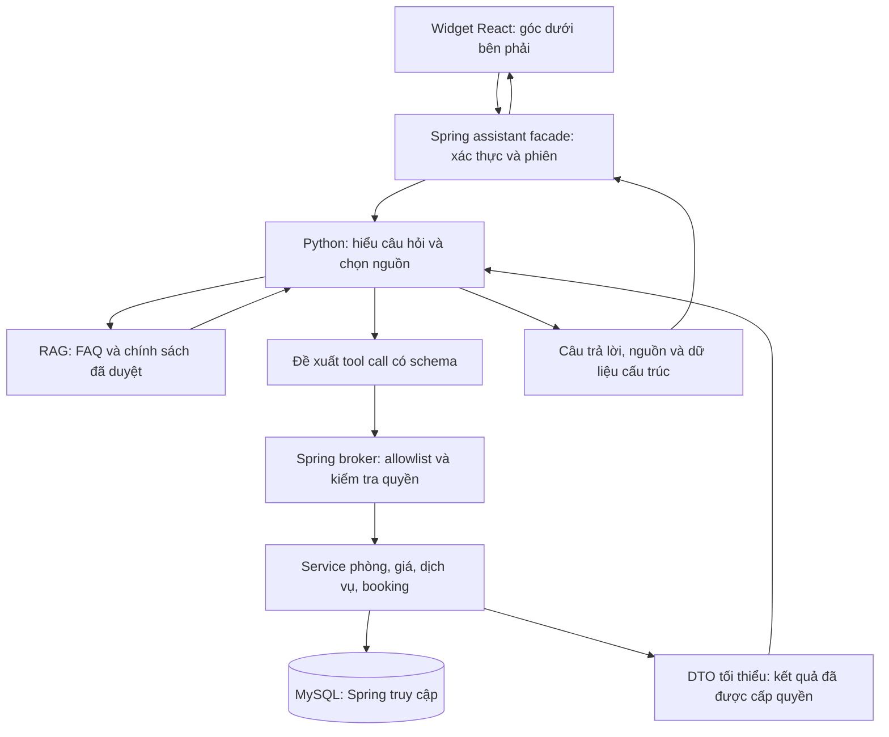

# Kiến trúc trợ lý khách sạn

Ngày: 2026-11-11, Asia/Ho_Chi_Minh.

Trạng thái: đã có foundation và implementation D1 FAQ với Gemini REST, index FTS5, Spring chat và widget opt-in. Kiểm thử mock không chứng minh chất lượng Gemini; chưa nghiệm thu live, chưa có nguồn production được duyệt. Các luồng nghiệp vụ/tool broker dưới đây vẫn là thiết kế cho D2–D4. Xem STATUS.md.

## Yêu cầu đã chốt

- Trợ lý đặt ở góc dưới bên phải giao diện.
- Hỗ trợ FAQ, phòng, giá phòng, dịch vụ, booking cá nhân cho khách đã đăng nhập và chính sách khách sạn.
- Dựa trên kiến trúc Microsoft; phân chia thư mục và AGENTS.md cho từng phạm vi.
- Giai đoạn đầu chỉ tra cứu. Các nút đặt/hủy/thanh toán dẫn đến luồng nghiệp vụ hiện có, chưa cho AI thao tác ghi.

## Pattern Microsoft và cách áp dụng

Microsoft mô tả RAG theo ba bước retrieve, augment, generate; nội dung truy xuất cần giữ metadata để truy nguồn. Dự án áp dụng vào FAQ, chính sách và hướng dẫn đã duyệt. Nguồn: [RAG và indexes](https://learn.microsoft.com/en-us/azure/foundry/concepts/retrieval-augmented-generation).

Với câu hỏi cần nhiều nguồn, Microsoft mô tả retrieval như một tool, các tool có mô tả/tham số rõ và vòng điều phối có giới hạn. Dự án áp dụng vào câu hỏi kết hợp tài liệu với phòng/dịch vụ/booking. Nguồn: [Develop an agentic RAG solution](https://learn.microsoft.com/en-us/azure/architecture/ai-ml/guide/rag/rag-agentic).

Đây là cách chuyển pattern sang React + Spring + Python của dự án; không phải cây thư mục mẫu bắt buộc của Microsoft. Không yêu cầu cài Azure, Microsoft Agent Framework hay dịch vụ tìm kiếm trả phí trong lần tổ chức này.

### Các hướng đã cân nhắc

| Hướng | Đánh đổi | Định hướng cho dự án |
| --- | --- | --- |
| Một index chứa mọi dữ liệu | Truy xuất đơn giản nhưng giá/booking dễ cũ, dữ liệu cá nhân khó kiểm soát | Không chọn cho dữ liệu nghiệp vụ sống |
| RAG tài liệu + tool nghiệp vụ có giới hạn | Tái sử dụng backend, có thể kiểm tra nguồn và quyền trước model | Đề xuất làm bản đầu |
| Agent tự do truy cập SQL/nhiều API hoặc nền tảng cloud đầy đủ | Phạm vi vận hành, quyền và chi phí lớn hơn nhu cầu hiện tại | Chưa đưa vào phạm vi |

## Phân loại nguồn

| Nhóm | Nguồn chuẩn | Cách trả lời |
| --- | --- | --- |
| FAQ | Nội dung khách sạn duyệt | Retrieval + trích dẫn |
| Chính sách | Tài liệu có phiên bản/ngày hiệu lực | Retrieval có lọc hiệu lực + trích dẫn |
| Phòng | RoomCatalogService | Tool dữ liệu cấu trúc; ranker tùy chọn cho ưu tiên mềm |
| Giá | Service nghiệp vụ hiện có | Trả số tiền/đơn vị từ backend; thiếu ngày ở thì hỏi lại |
| Dịch vụ | Danh mục dịch vụ đang hoạt động | Tool lấy giá/trạng thái; retrieval cho hướng dẫn |
| Booking cá nhân | Service booking/history, theo principal | Tool có kiểm tra ownership trước khi trả trường tối thiểu |

FAQ dẫn về chính sách gốc khi giải thích quy định. Khi tài liệu và dữ liệu live khác nhau, giá/trạng thái lấy từ backend; mâu thuẫn quy định phải được báo để rà soát, không tự ghép thành chính sách mới.

## Luồng online đề xuất



1. React gửi câu hỏi qua Spring; JWT chỉ tới Spring. Backend quyết định trạng thái guest/member; không tin account ID trong câu hỏi hoặc browser state.
2. Python xử lý RAG cục bộ cho tài liệu công khai. Với dữ liệu nghiệp vụ, trả yêu cầu tool có tên/arguments đã định nghĩa; không tự kết nối MySQL hay gọi tùy ý HTTP.
3. Spring giữ principal xuyên suốt request, kiểm tra tool và ownership, gọi service nghiệp vụ trực tiếp. Không gọi vòng HTTP vào route assistant.
4. Spring gửi kết quả tối thiểu cho Python tổng hợp; không chuyển JWT hoặc khóa nội bộ vào prompt/tool result. Hai chiều Spring–Python dùng xác thực service do server cấu hình, tách khỏi JWT người dùng.
5. Nếu còn thiếu dữ liệu, hỏi lại hoặc thực hiện vòng tool tiếp theo trong ngân sách. Mức khởi đầu đề xuất: tối đa 4 tool calls nghiệp vụ và 2 vòng trao đổi/request; deadline và token cap cấu hình khi triển khai, chưa có số đo.
6. Spring đối chiếu call ID, request/phiên, reference và link trước khi trả UI. Chỉ chấp nhận citation trỏ đến chunk thực sự truy xuất; không tin citation model tự dựng.

Trạng thái trả lời dự kiến gồm: có câu trả lời, cần bổ sung thông tin, cần đăng nhập, không có kết quả, không đủ bằng chứng và lỗi phụ thuộc. Không biến timeout hoặc nguồn thiếu thành thông tin khách sạn tự suy đoán.

## Luồng offline: chuẩn bị tài liệu

Tài liệu được duyệt → kiểm tra metadata → chia theo tiêu đề/mục → embedding/index → snapshot có manifest → retrieval.

- Bản đầu lấy tài liệu từ Git, chưa tạo chức năng upload cho khách.
- Chỉ nạp nguồn được cấu hình; không crawl URL do người hỏi cung cấp.
- Metadata tối thiểu: document_id, title, category, version, effective_from, effective_to, approved, source_ref, chunk_id và checksum.
- Tách tài liệu hết hiệu lực, chưa duyệt khỏi retrieval thông thường; không lấy file AGENTS.md/README.md hướng dẫn phát triển làm kiến thức khách sạn.
- Cache/index là dữ liệu dẫn xuất, có thể tái tạo; đổi nội dung/model revision phải làm mất hiệu lực snapshot cũ.
- Dữ liệu booking, thông tin liên hệ và lịch sử chat cá nhân không đi qua pipeline index công khai.

Khi chưa có corpus khách sạn được duyệt, D1 được dùng chế độ test/demo tường minh: chỉ đọc fixture synthetic được allowlist, tạo index/manifest riêng có nhãn synthetic, không ghi đè hoặc được cấu hình public/live chọn làm corpus thật. Giao diện demo phải hiện nhãn dữ liệu giả lập. Không tự chuyển sang fixture khi nguồn thật lỗi/thiếu.

## Cây thư mục

Mỗi thư mục mới dưới đây có `AGENTS.md`. Các module D1 đã được thêm theo từng task; sơ đồ còn gồm phạm vi dự kiến D2–D4, không có nghĩa mọi tool đã triển khai.

```text
PBL6/
├── AGENTS.md
├── FE/
│   ├── AGENTS.md
│   └── src/components/assistant/  # Widget, tin nhắn, thẻ và nguồn
├── BE/
│   ├── AGENTS.md
│   └── src/main/java/com/example/pbl6/
│       ├── controller/assistant/ # HTTP, principal và phiên
│       ├── service/assistant/    # Tool broker, orchestration, nghiệp vụ
│       └── dto/assistant/        # Contract tối thiểu, không serialize entity
└── ai-service/
    ├── AGENTS.md
    ├── app/
    │   ├── AGENTS.md
    │   ├── api/                 # Transport FastAPI nội bộ
    │   ├── orchestration/       # Router ý định, vòng tool, tổng hợp
    │   ├── retrieval/           # Tìm chunk, lọc metadata, citation
    │   ├── tools/               # Khai báo tool, không giữ quyền của khách
    │   ├── ingestion/           # Nạp/chia/index tài liệu offline
    │   ├── providers/           # Adapter LLM/embedding/index
    │   ├── schemas/             # Message, tool, evidence, error
    │   └── prompts/             # Chỉ dẫn model, quản lý phiên bản
    ├── knowledge/
    │   ├── AGENTS.md
    │   ├── faq/                 # Câu hỏi thường gặp đã duyệt
    │   ├── policies/            # Chính sách gốc và hiệu lực
    │   └── services/            # Hướng dẫn dịch vụ; giá từ backend
    ├── tests/
    │   ├── AGENTS.md
    │   ├── unit/                # Logic cô lập
    │   ├── integration/         # Contract/service thật
    │   ├── evaluation/          # Chất lượng retrieval/câu trả lời
    │   └── fixtures/            # Chỉ synthetic, có nhãn
    └── docs/
        ├── AGENTS.md
        ├── architecture.md      # Kiến trúc và cây thư mục
        ├── API.md               # Hợp đồng chat, tool và health đề xuất
        ├── UI.md                # Widget góc dưới bên phải
        ├── PLAN.md              # Lộ trình triển khai
        ├── EVALUATION.md        # Kế hoạch đánh giá
        └── STATUS.md            # Trạng thái thực tế
```

## Điểm tích hợp đã khảo sát trong repository

| Phần đang có | Tái sử dụng / giới hạn |
| --- | --- |
| FE/src/App.jsx | Router và AuthProvider; vị trí gắn widget một lần |
| FE/src/contexts/AuthContext.jsx | Theo dõi login/logout; UI không tự quyết quyền |
| FE/src/services/api.js | API client qua Spring; giữ convention hiện có |
| RoomCatalogService; GET /api/public/rooms/room-types, /available | Danh mục và phòng trống theo ngày/số khách; chưa phải một engine giá động mới |
| PublicBillingController; GET /api/public/services | Danh mục dịch vụ đang hoạt động qua CustomerBillingService |
| CustomerBookingController; GET /api/customer/bookings/my-bookings | Danh sách booking của principal |
| CustomerBookingController; GET /api/customer/bookings/history/{bookingCode} | Service có nhánh kiểm tra chủ booking; cần rà lại fallback email/SĐT trước tool AI |
| Recommendation cũ | Facade đã gỡ khỏi source; không tái sử dụng proxy cũ cho assistant |

Các đường dẫn HTTP trong bảng là API nghiệp vụ để tái sử dụng sau D1. [API.md](API.md) phân biệt phần chat/final FAQ đã hiện thực và tool-result/business tools chưa triển khai. D1 mở đúng POST chat/DELETE session bằng matcher riêng; không mở toàn bộ `/api/ai/**`.

## Ranh giới bảo mật và phiên

- Booking: chỉ quan hệ sở hữu đã được xác thực; không dùng email/SĐT chưa xác minh hoặc mã booking đơn lẻ làm bằng chứng quyền.
- Lọc quyền trước khi dữ liệu vào context model; không lấy dữ liệu của nhiều người rồi yêu cầu model tự che.
- Hội thoại được server ràng buộc theo phiên và account; conversation ID là tham chiếu, không là bằng chứng quyền. Đăng xuất/đổi account phải vô hiệu hóa truy cập phiên cũ và chặn phản hồi đến muộn.
- Bản đầu đề xuất giữ trạng thái ngắn hạn trong bộ nhớ, có TTL cấu hình và không lưu lâu dài; chưa thêm database/Redis cho chat.
- Nội dung tài liệu, câu hỏi và output model là dữ liệu không đáng tin cậy. Các giới hạn tool và quyền được thi hành trong code ngoài prompt.
- Chỉ log request ID, tool name, mã kết quả và timing đã làm sạch; không ghi nội dung booking, raw prompt, token hoặc suy luận nội bộ của model.

## Quyết định còn mở

D1 đã chọn Gemini REST gemini-3.1-flash-lite và SQLite FTS5/BM25, không embedding, snapshot dưới .local/assistant-index tách mode. Lý do: corpus nhỏ, không phải tải model/vector service và có baseline tái lập. Đánh đổi: lexical retrieval hạn chế paraphrase; model/provider thật chưa nghiệm thu do thiếu key. Schema D1 theo API.md; chi phí/latency thực chưa đo. Các lựa chọn hybrid/embedding/ranking hoặc mở rộng tool chỉ xem xét ở lát sau theo dữ liệu đánh giá.

## Đọc tiếp

- [Bố cục widget](UI.md).
- [Hợp đồng API đề xuất](API.md).
- [Lộ trình triển khai](PLAN.md).
- [Kế hoạch đánh giá](EVALUATION.md).
- [Trạng thái thực tế](STATUS.md).
