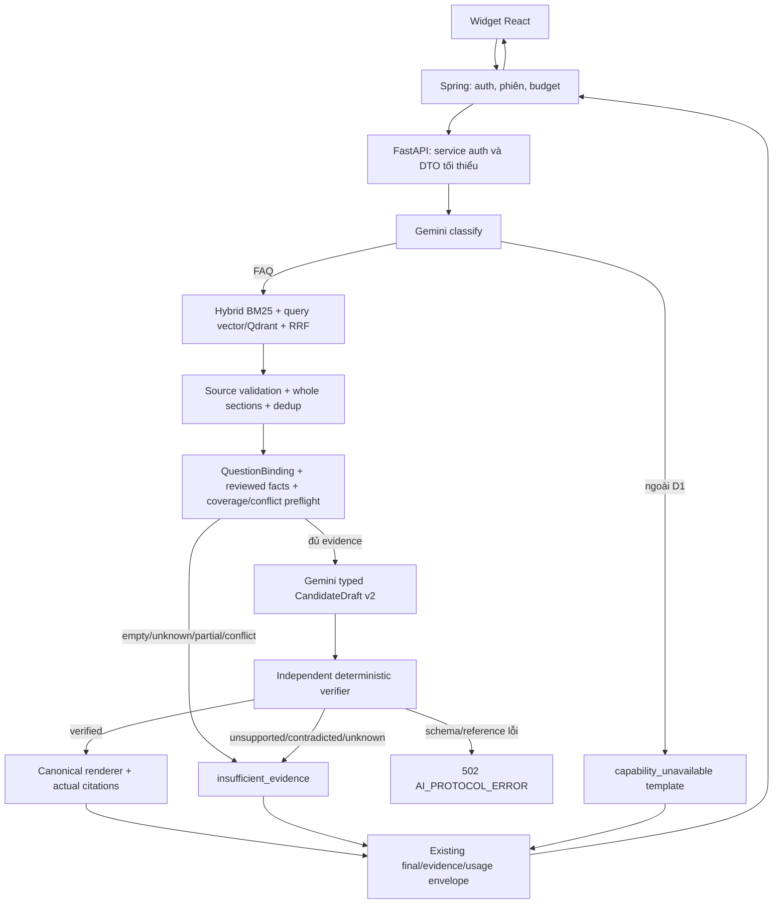
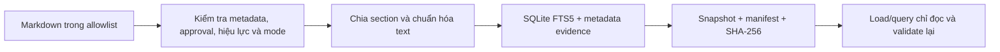
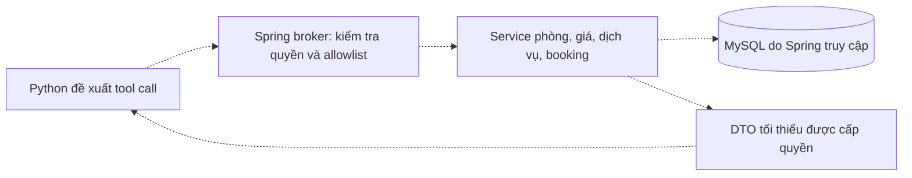
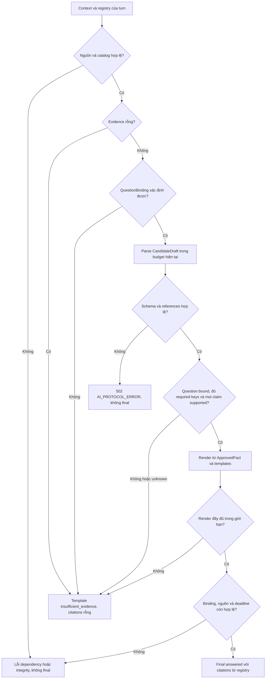
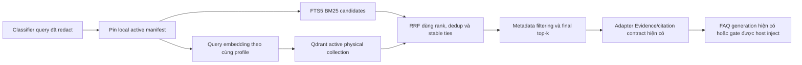

# Kiến trúc trợ lý khách sạn

Cập nhật: **2026-11-21**, working tree tại HEAD `c031267`, merge `origin/main` chưa commit.
Phase 3 đã nối gate D1.20 vào factory và mọi FAQ; default retrieval là hybrid. Public API,
Spring/React, generation model và tổng budget không đổi. Bằng chứng/acceptance ở
[PROCESS](PROCESS.md#phase-3--grounded-generation), runbook ở [GROUNDING](GROUNDING.md).

**Đang sử dụng: RAG với luồng điều phối cố định cho FAQ trong miền facts được duyệt.**
React/Vite → Spring Boot → FastAPI → Hybrid BM25/Qdrant → context → typed Gemini proposal →
verification → canonical rendering/abstention. Có kiểm chứng offline/Docker, chưa có Gemini
run mới hoặc corpus/catalog production được duyệt. Reliability/semantic D1 vẫn mở; business
broker, booking và agent loop D2–D4 chưa triển khai.

## Phân chia trách nhiệm hiện tại

| Thành phần | Vai trò đã có | Điểm vào/source |
| --- | --- | --- |
| React/Vite | Widget góc dưới bên phải, gửi chat/reset tới Spring, hiện nguồn/nhãn demo, hủy request và bỏ phản hồi muộn khi đổi account | [AssistantWidget.jsx](../../FE/src/components/assistant/AssistantWidget.jsx), [api.js](../../FE/src/services/api.js) |
| Spring Boot | Xác thực guest/member, ràng buộc phiên/owner, idempotency/TTL, budget, kiểm tra response/evidence/citation từ Python | [AssistantController.java](../../BE/src/main/java/com/example/pbl6/controller/assistant/AssistantController.java), [AssistantSessions.java](../../BE/src/main/java/com/example/pbl6/service/assistant/AssistantSessions.java), [AssistantClient.java](../../BE/src/main/java/com/example/pbl6/service/assistant/AssistantClient.java) |
| FastAPI | API nội bộ với service auth, validation/body cap/request ID, lifecycle và health/readiness | [main.py](../app/main.py), [boundary.py](../app/api/boundary.py) |
| FAQ orchestration | Classify, một retrieval, context selection, typed claims, gate bắt buộc và verified renderer | [faq.py](../app/orchestration/faq.py) |
| Gemini adapter | REST countTokens/generateContent qua HTTPX; structured JSON, kiểm tra schema/usage, budget và lỗi | [gemini.py](../app/providers/gemini.py), [contracts.py](../app/providers/contracts.py) |
| Ingestion/retrieval | Paired FTS5/Qdrant offline, hybrid/RRF, source approval/version/checksum, tối đa ba evidence | [snapshot.py](../app/ingestion/snapshot.py), [index.py](../app/retrieval/index.py) |
| Diagnostics | Events tổng hợp và timing HTTP theo request; bỏ dữ liệu nhạy cảm, queue timing có giới hạn | [diagnostics.py](../app/diagnostics.py), [http_timing.py](../app/providers/http_timing.py) |

Python runtime dùng FastAPI/Uvicorn, Pydantic/Pydantic Settings, HTTPX và PyYAML; SQLite FTS5 có sẵn. Phiên bản khóa trong [requirements.lock](../requirements.lock). Chat mặc định dùng hybrid/query embedding/Qdrant trên paired snapshot; explicit BM25 legacy vẫn yêu cầu gate. Không thêm dependency Python, LangChain, SDK Gemini, Redis hoặc Azure.

## Luồng online D1 đã triển khai



1. Spring giữ JWT/principal/owner và gửi DTO/service credential tối thiểu; Python không đọc
   MySQL hoặc nhận JWT khách. Redaction theo mẫu không bảo đảm loại mọi PII tự do.
2. Factory chỉ ready sau valid snapshot, separately pinned catalog/source receipts và Gemini
   startup probe. Không có gate thì fail-closed, không fallback free-form.
3. FAQ dùng cùng TurnBudget cho classify, một retrieval và typed answer nếu preflight cho
   phép. Mọi evidence giữ actual source/version/chunk/excerpt/mode. Classifier query phục vụ
   retrieval; QuestionBinding lấy original message và closed reviewed aliases.
4. Context giữ whole sections, exact dedup và tối đa ba evidence. Token cap configurable
   kiểm tra toàn answer input bằng countTokens hiện có; không vừa thì budget error, không
   cắt scope/ngoại lệ. Offered facts có binding thực và thuộc question scope.
5. Model trả CandidateDraft v2, không supported/answer prose. Gate độc lập kiểm schema, refs,
   typed tuple, qualifiers/unit/time, coverage và conflicts trong reviewed slice. Citation
   hợp lệ thuộc fact khác gây abstention; reference sai protocol gây 502.
6. Renderer chỉ phát canonical facts qua templates được duyệt, citations từ actual registry;
   không release partial support. Catalog/source drift là 503, không giả insufficient evidence.
7. Public Spring/React contract giữ nguyên. Reset session ở Spring; resume trả 409
   CONTINUATION_NOT_FOUND, chưa có tool continuation/booking.

20 giây tích lũy từ Spring, 8000 input/2000 output, tối đa hai generation và một retrieval
không đổi. countTokens trước mỗi generation; query embedding/vector search dùng shared
deadline. Embedding cost chưa nằm trong generation usage. Source/index validation còn đồng
bộ và phần đầu trước budget; chưa là hard wall-clock/CPU SLO guarantee.

Miền deterministic phụ thuộc reviewer trích đúng facts/qualifiers/templates. Không bảo đảm
free-form prose entailment; G20 giữ phản ví dụ catalog duyệt sai. Chưa có catalog/corpus
production hoặc bằng chứng Gemini semantic quality mới.

## Luồng offline và nguồn kiến thức



- Ingestion chạy offline bằng module `app.ingestion.snapshot`, không tự build khi startup và không crawl/upload URL do khách cung cấp.
- Snapshot nằm ở `.local/assistant-index/<mode>/<snapshotId>/`, có `index.sqlite` và `manifest.json`; output đã ignore, có thể tái tạo.
- `demo_synthetic` chỉ nạp [fixture FAQ](../tests/fixtures/d1/faq.md); production chỉ nạp bốn file knowledge trong allowlist của `SOURCES`. Hai mode có snapshot riêng, không tự fallback.
- Metadata nguồn gồm document ID/title/category/version/source reference, approval và ngày hiệu lực. Evidence giữ citation ID, document/version/chunk/section, excerpt và corpus mode.
- [Knowledge hiện có](../knowledge/README.md) gồm FAQ chung, danh mục hạng phòng, thông tin schema booking và hướng dẫn dịch vụ; toàn bộ vẫn `approved=false`/pending review. Chưa có policy thật đủ điều kiện index. README/AGENTS không phải nguồn RAG.
- Không nạp booking thật, thông tin liên hệ hoặc lịch sử chat cá nhân vào kho kiến thức chung. Giá/tồn phòng/trạng thái dịch vụ phải lấy từ service nghiệp vụ ở các bước sau.

FTS5 giữ lexical baseline; paired ingestion/hybrid query dùng Qdrant/query embeddings theo [INGESTION](INGESTION.md) và [HYBRID](HYBRID.md). Catalog/source receipts là publication riêng theo [GROUNDING](GROUNDING.md). Chưa có reranking/agent loop.

## Khởi động, lỗi và quan sát

- Token/key/index được đọc qua [Settings](../app/settings.py); model mặc định `gemini-3.1-flash-lite`, không khẳng định đây là cấu hình thực tế của mọi process đang chạy.
- Startup chỉ gắn FAQ sau khi index + catalog/source receipts hợp lệ và probe Gemini thật thành công trong budget 5 giây. `/health` kiểm tra process sống; `/ready` kiểm tra cấu hình, index và trạng thái dependency.
- Khi turn gặp `DEPENDENCY_UNAVAILABLE`, FastAPI giữ latch not-ready đến restart sau khắc phục. Deadline trả lỗi riêng, không tự retry/fallback. Không gọi model lại ở mỗi lần đọc `/ready`.
- Service auth được kiểm tra trước body nội bộ; body cap 128 KiB, provider/response Spring cap 256 KiB. Swagger/OpenAPI không mở trong factory hiện tại.
- Diagnostics D1.8 dùng UUID nội bộ, phase/category/duration/budget/status đã làm sạch. Timing D1.10 dùng HTTPX trace theo request, tối đa 32 samples và queue 128 records; worker ghi stderr, delivery best effort, không drain/join trên request path.
- Thiếu phase hoặc terminal timing là unavailable, không suy 0 ms, connection reuse hoặc Gemini compute time. [D1.10_HTTP_TIMING.md](D1.10_HTTP_TIMING.md) giữ schema, cách diễn giải và giới hạn.

## Kiến trúc mục tiêu D2–D4: chưa triển khai

Spring tiếp tục sở hữu MySQL, xác thực, quyền, giá, tồn phòng và booking. Python chỉ đề xuất tool call typed; Spring sẽ kiểm tra allowlist/schema/ownership, gọi service trực tiếp rồi gửi DTO tối thiểu đã cấp quyền để tổng hợp.



Sơ đồ nét đứt là thiết kế tương lai; hiện D1 không thực thi chuỗi này. Mức tối đa bốn tool calls/hai vòng từng được đề xuất cho các bước sau chưa phải hành vi runtime D1.

| Nhóm | Nguồn chuẩn / điểm tái sử dụng | Trạng thái assistant |
| --- | --- | --- |
| FAQ/chính sách | Tài liệu khách sạn duyệt, có version/hiệu lực | Pipeline FAQ chạy trên synthetic; corpus production chưa duyệt |
| Phòng | `RoomCatalogService`; `/api/public/rooms/room-types`, `/available` | Chưa nối `search_rooms` |
| Giá | Kết quả nghiệp vụ từ backend; đơn vị/currency/kỳ ở rõ ràng | Chưa nối tool; chưa tạo engine giá hoặc `get_room_quote` |
| Dịch vụ | `CustomerBillingService`; `/api/public/services` | Chưa nối `list_services`; knowledge chỉ cho hướng dẫn |
| Booking cá nhân | `CustomerBookingController`/`CustomerHistoryService` theo principal | Chưa mở tool; phải rà ownership/fallback email/SĐT trước |

Không đưa giá hoặc booking vào index để thay thế dữ liệu sống. Không mở thao tác ghi đặt/hủy/thanh toán qua chat; các action sau này dẫn tới màn hình nghiệp vụ hợp lệ.

## Bảo mật và giới hạn triển khai

- Spring đang giữ phiên in-memory, gắn owner/TTL và kiểm soát kết quả sau reset; chưa có shared session store cho nhiều instance. FE xóa chat/hủy request khi đổi account, không lưu chat vào browser storage.
- Không dùng conversation ID, mã booking hoặc email/SĐT chưa xác minh làm bằng chứng quyền. Quyền booking của D3 phải được kiểm tra trong Spring trước khi dữ liệu vào model.
- Câu hỏi, knowledge, tool result và output model đều phải được xem là dữ liệu không đáng tin cậy; quyền/allowlist/budget thực thi bằng code ngoài prompt.
- Không gửi JWT khách, provider key hoặc token nội bộ vào model/index/log. Diagnostics không lưu raw query/prompt/answer, URL/header, PII hoặc raw exception.
- Spring mặc định `assistant.enabled=false`; FE bật tường minh bằng `VITE_ASSISTANT_ENABLED=true`, ẩn widget ở admin/staff. Demo synthetic chỉ được phép trong profile local.
- Không có kết nối Python→MySQL. Gemini là dependency mạng ngoài; reliability live vẫn còn blocker theo [PROCESS](PROCESS.md), chưa xác định nguyên nhân sâu network/provider. Chưa có căn cứ gọi hệ thống sẵn sàng production.

## Cây module thực tế

```text
ai-service/
├── app/
│   ├── main.py, settings.py, diagnostics.py
│   ├── api/boundary.py
│   ├── orchestration/faq.py, orchestration/verification/
│   ├── ingestion/snapshot.py
│   ├── retrieval/{index,hybrid,fusion}.py
│   ├── providers/{contracts,gemini,http_timing}.py
│   ├── schemas/{turn,faq}.py
│   ├── prompts/{faq,verified_faq}.py
│   └── tools/                 # Hiện chỉ có hướng dẫn, chưa có executor
├── knowledge/                 # Bản nháp chờ duyệt, không phải corpus production
├── tests/{unit,integration,evaluation,fixtures}/
├── docs/
│   ├── PROCESS.md             # Checklist, bằng chứng và việc tiếp theo
│   ├── architecture.md        # Hiện tại và thiết kế D2–D4
│   ├── API.md                 # Contract, phân biệt đã có/chưa có
│   ├── UI.md, EVALUATION.md    # Đặc tả riêng, có ghi phạm vi hiện hành
│   └── D1.*.md                # Báo cáo chuyên sâu còn giá trị
├── requirements{,-dev}.txt, requirements.lock
└── settings.example.env
```

Cách phân chia thư mục là lựa chọn của dự án. Pattern RAG và việc tổ chức retrieval như tool tham khảo tài liệu Microsoft; không có nghĩa dự án đang dùng Azure hay Microsoft Agent Framework. Các liên kết tham khảo gốc: [RAG và indexes](https://learn.microsoft.com/en-us/azure/foundry/concepts/retrieval-augmented-generation), [Agentic RAG](https://learn.microsoft.com/en-us/azure/architecture/ai-ml/guide/rag/rag-agentic).

Xem [README](../README.md) để chạy local, [API](API.md) để tích hợp, [UI](UI.md) và [EVALUATION](EVALUATION.md) cho đặc tả chi tiết. Trạng thái nghiệm thu lấy từ [PROCESS](PROCESS.md).

## D1.18 — semantic verification gate: thiết kế đề xuất, chưa triển khai

Phần này giữ lý do thiết kế D1.18. Contract chi tiết được hoàn thiện tại [D1.19](#d119--contract-cho-semantic-verification-gate-chỉ-đặc-tả); nếu khác draft bên dưới, lấy D1.19 làm oracle. Đây là đặc tả lịch sử: tại mốc D1.20 có core/adapter opt-in; Phase 3 đã nối factory/runtime theo [GROUNDING](GROUNDING.md). Chưa có catalog production hoặc nghiệm thu semantic.

Mục tiêu là chặn câu trả lời có claim không được nguồn hỗ trợ trước khi tạo final hoặc lưu lịch sử. Phạm vi đề xuất ban đầu chỉ là FAQ tĩnh, gồm demo có nhãn; không mở tools, giá/tồn phòng/booking hoặc thay quyền của Spring. Giả định thiết kế: giữ public envelope hiện có, không thêm verifier LLM call, không nới budget/deadline. Đây là lựa chọn để review, không phải tính năng đang bảo vệ runtime. [Test matrix](EVALUATION.md#d118--test-matrix-cho-semantic-verification-gate-đề-xuất) chưa được thực thi; tiến độ chỉ ghi tại PROCESS.

Gate áp dụng cho nhánh FAQ đề xuất trả facts. Các template capability_unavailable/insufficient_evidence do code tạo vẫn là thông báo khả năng/thiếu nguồn, không cần citation fact khách sạn; không cho model chèn prose vào template đó.

### Hiện tại: supported và citation đến từ đâu

1. [ANSWER prompt](../app/prompts/faq.py) yêu cầu Gemini dùng evidence, đặt supported=false khi không trả lời được đúng câu hỏi và giữ ngoại lệ/giới hạn. supported=true là **tự đánh giá trong JSON do model sinh**, không phải kết quả kiểm định độc lập.
2. [Gemini._parse](../app/providers/gemini.py) kiểm tra finishReason/usage, parse JSON qua [GroundedAnswer](../app/schemas/faq.py): supported là bool, answer là text 1–4000 ký tự, citationIds tối đa ba. Schema đúng không chứng minh nội dung đúng; schema hiện không có claims hoặc claim→citation mapping.
3. [Faq._run](../app/orchestration/faq.py) trả template thiếu nguồn khi evidence rỗng hoặc supported=false. Khi true, citationIds phải không rỗng, không trùng và thuộc evidence registry của lượt; nếu sai, trả AI_PROTOCOL_ERROR. Metadata citation được ghép từ registry, không lấy từ model. Sau đó result.answer được chuyển nguyên văn vào final.
4. [Spring AssistantClient](../../BE/src/main/java/com/example/pbl6/service/assistant/AssistantClient.java) kiểm tra response fields/turn IDs/mode/budget, evidence IDs duy nhất, citation thuộc registry và từng trường metadata khớp, answered phải có citation. Spring không đối chiếu nghĩa answer với excerpt; registry ở đây đến từ Python, không phải một lần retrieval độc lập ở Spring.

Quan hệ cần có là **mỗi claim → một hoặc nhiều support spans → chunks thực được retrieve và gửi vào generation**. Hiện chỉ có answer text + danh sách citations ở mức response. Một citation có thể hỗ trợ một claim nhưng không hỗ trợ claim khác trong cùng answer; citation identity không chứng minh support hoặc coverage. D1.17 đã characterization điều này bằng fake provider cố ý sai, không phải bằng chứng Gemini thật đã sinh claim đó.

### Ranh giới của deterministic verification

| Có thể kiểm tra bằng code | Điều chưa được chứng minh bởi kiểm tra đó |
| --- | --- |
| Kiểu/schema, IDs duy nhất, citation thuộc đúng turn/registry, version/hash/mode/hiệu lực | Claim được nguồn hỗ trợ về nghĩa hoặc nguồn mô tả đúng khách sạn thật |
| Quote bằng đúng substring của excerpt, offsets và checksum hợp lệ | Quote trả lời đúng câu hỏi, đủ ngữ cảnh, không bỏ phủ định/ngoại lệ |
| Claim typed bằng đúng fact đã duyệt, đủ qualifiers, đúng source bindings và renderer cố định | Tính đúng/đủ của việc con người đã biên tập fact từ prose; đảm bảo ngoài miền facts đã duyệt |
| Mâu thuẫn của facts typed cùng phạm vi theo rule loại trừ đã định nghĩa | Mọi mâu thuẫn ngôn ngữ tự nhiên, ngoại lệ ngầm hoặc thứ tự ưu tiên policy chưa có rule |
| Mọi phần output do renderer tạo đều có fact mapping; đủ required keys của câu hỏi đã bind | Claim extraction đầy đủ từ văn bản tự do hoặc hiểu được mọi câu hỏi/paraphrase |

Không dùng token overlap, BM25, substring, regex phủ định hoặc citation ID như một entailment oracle. Model/NLI judge có thể cung cấp semantic judgment nhưng vẫn có thể sai; đặt thêm một judge không biến kết quả thành chứng minh deterministic và sẽ cần đánh giá/budget riêng. D1.18 không đề xuất thêm call đó vào đường D1 hiện tại.

**Hướng đề xuất:** deterministic release gate cho một miền đóng gồm facts/qualifiers/templates đã được người phụ trách duyệt. Code kiểm tra đối chiếu trong miền đó; semantic judgment được thực hiện khi biên tập nguồn/facts, không giả là đã giải quyết toàn bộ NLP tại runtime. Với free-form answer hiện tại, không có cách tổng quát trong thiết kế này để tự tách đủ claims và chứng minh entailment: đánh giá unknown thì fail-closed. Chỉ thêm kiểm tra quote vào schema cũ chưa đóng được gap D1.17.

### Contract nội bộ đề xuất

Tên/type dưới đây chỉ mô tả interface tương lai, chưa có module hoặc artifact catalog tương ứng trong repository. Không thay contract [API.md](API.md), schema/prompt hiện tại hoặc thêm field vào envelope mà Spring đang kiểm tra exact fields.

| Type / bên tạo | Nội dung và invariant |
| --- | --- |
| VerificationContext — code | requestId/conversationId/turnId/diagnosticId, mode/today, snapshotId, registryHash, catalogVersion/hash và rendererVersion; cùng budget đang dùng. Registry immutable gồm đúng evidence thực nhận/thực gửi, không chứa dữ liệu lịch sử thay cho nguồn. Không cho model cấp hay sửa context này |
| ApprovedCatalog — người phụ trách duyệt offline, code pin | Version/hash, reviewedChunkHashes, facts, conflict rules và renderer allowlist. Review declaration bao gồm điều kiện/ngoại lệ/mâu thuẫn của miền nguồn. Chunk không có review entry phù hợp → unknown; cả catalog bắt buộc hỏng/thiếu → dependency error. Code kiểm tra binding/declaration, không tự xác minh chất lượng review |
| ApprovedFact — catalog do người phụ trách duyệt offline | Một mệnh đề atomic gồm factId, subjectId, predicate, value typed, qualifierIds bắt buộc, phạm vi/hiệu lực, source bindings và rendererKey/version; conjunction phải tách thành nhiều facts/claims. Giai đoạn đầu chỉ bool hoặc enum được allowlist cho FAQ; không suy số tiền/ngày/booking từ prose. Chưa có catalog đã duyệt; Markdown approved và catalog facts approved là hai điều kiện riêng |
| SourceBinding — catalog + code đối chiếu | citationId/documentId/version/chunkId/sectionId, excerptSha256 và spans [start,end) trên excerpt gốc theo Unicode code points. 0≤start<end≤len(excerpt), quote đúng substring, hash đúng bytes UTF-8. Không dùng text bỏ dấu làm bằng chứng đồng nhất; mọi span/qualifier cần thiết phải còn trong chunks của lượt |
| QuestionBinding — code/rule đã duyệt | subject và required fact keys/qualifiers cho FAQ entry/grammar được nhận diện tường minh. Classifier/query rewrite/model không được tự chứng nhận binding. Giai đoạn đóng chỉ hỗ trợ full-match alias/grammar được duyệt, giữ phủ định và điều kiện; không bind bằng substring/generic tokens. Câu tự do ngoài miền hoặc nhiều cách hiểu → question_unbound |
| CandidateDraft — model, không đáng tin | Exact outer fields: schemaVersion=d1-claim-proposal-1, decision và claims. Discriminated union: abstain có claims=[]; propose_answer có 1–6 claims. Mỗi claim có claimId duy nhất, factId, subjectId, predicate, value, qualifierIds (tối đa tám, không trùng) và 1–3 citationIds duy nhất. IDs tối đa 128 ký tự; predicate/value/qualifiers thuộc vocabulary đã version. Không nhận answer text tự do, supported flag, explanations hoặc field thừa. Giới hạn sáu claims là cap đề xuất, không phải khả năng runtime đã có |
| VerificationResult — chỉ code tạo | outcome=verified, abstain hoặc invalid; perClaim verdict=supported, unsupported, contradicted hoặc unknown; reason code hữu hạn. verified kèm rendered answer/citations do code tạo. Deadline/dependency/internal failures vẫn đi error path riêng, không tự chuyển thành abstain |

Boundary đề xuất là `verify(context, questionBinding, registry, approvedCatalogSlice, candidate) -> VerificationResult`, đặt ở orchestration sau parse provider và trước tạo final; chỉ code gọi, không phải HTTP endpoint/tool do model thực thi. Verifier không gọi mạng/retrieval/model và không tự sửa catalog. Host chuẩn bị slice facts được phép từ các chunks thực gửi, cấp IDs/vocabulary cần thiết cho generation trong token budget hiện có; không gửi toàn catalog hay cho model tự bổ sung facts. registry/context/binding vẫn do host giữ, không nhận lại bản ghi thay thế từ output model.

Ví dụ CandidateDraft **đề xuất**, IDs chỉ minh họa, không phải catalog/fixture đã được phê duyệt:

```json
{
  "schemaVersion": "d1-claim-proposal-1",
  "decision": "propose_answer",
  "claims": [{
    "claimId": "c1",
    "factId": "demo-luggage-flammable-v1",
    "subjectId": "demo-hotel",
    "predicate": "accepts_flammable_luggage",
    "value": false,
    "qualifierIds": ["demo-only"],
    "citationIds": ["<retrieved-luggage-chunk-id>"]
  }]
}
```

approved facts không được tự tạo/duyệt từ generation của chính lượt. Catalog phải pin vào nguồn/version/excerpt và được rà đủ các điều kiện/ngoại lệ/phạm vi của miền hỗ trợ; code không chứng minh được người duyệt đã trích đủ ý từ prose. Đó là giả định và công việc semantic review phải nghiệm thu riêng. Không tự đọc facts từ chunk khác chỉ vì nó có trong catalog nhưng không được retrieve/gửi trong lượt này.

Claim được coi supported trong profile đóng khi tuple subject/predicate/value/qualifiers bằng ApprovedFact áp dụng, tất cả source bindings hợp lệ và citationIds bằng tập citation cần thiết của fact. Citation hợp lệ nhưng trỏ sang fact khác là unsupported; không cho citation padding bằng các IDs không hỗ trợ claim. Nhiều spans chỉ được ghép theo fact/rule đã duyệt, không tự suy một kết luận mới từ hai passages.

Rules mâu thuẫn phải nêu cardinality/điều kiện loại trừ cho từng predicate và scope. Hai giá trị khác nhau không mặc nhiên mâu thuẫn nếu predicate đa trị hoặc khác hiệu lực. Facts cùng scope thật sự loại trừ nhau → contradicted; thiếu rule/không rõ phiên bản áp dụng hoặc có prose chưa được catalog rà về ngoại lệ/mâu thuẫn → unknown. Không tự chọn bản mới nhất, passage rank cao hơn hay lấy trung bình để vượt gate.

### Decision flow và fail-closed



1. Pin context/registry, validate nguồn và catalog trước khi xét draft. Evidence rỗng giữ nhánh không gọi answer như hiện tại. Nếu đã xác định question_unbound thì abstain, không gọi thêm model để tự cấp binding. Candidate abstain luôn giữ template; không ép model trả lời.
2. Trước semantic decisions, validate schema/IDs/references/spans. Thiếu citation cho một claim, citation ngoài registry/trùng/sai turn, schema version không hỗ trợ hoặc span bất hợp lệ là invalid. Model proposal có factId không tồn tại trong tập được cung cấp cũng là invalid. ID hợp lệ nhưng proposition hoặc source không hỗ trợ claim là unsupported/unknown, không được thăng thành verified.
3. Kiểm tra cả bộ claims và required keys từ QuestionBinding. Chỉ khi mọi claim supported, không có conflict và không thiếu phần bắt buộc mới render. Một phần unsupported/contradicted/unknown thì từ chối **toàn answer**, không tự bỏ claim rồi trình bày phần còn lại như đầy đủ. Không có text tự do ngoài renderer, nhờ đó model không thể giấu claim mới trong lời mở đầu/kết luận.
4. Renderer dùng canonical values và qualifiers của ApprovedFact, không dùng prose/quote tùy ý của model. Giữ nhãn demo, ngoại lệ và thời gian áp dụng; tạo citations là union duy nhất của mappings đã qua gate, tối đa ba nguồn. Nếu không render đầy đủ trong giới hạn answer hiện có (4000 ký tự) thì không cắt âm thầm làm mất qualifier.
5. Recheck source/binding/limits và deadline trước release; không stream draft hoặc lưu draft vào history. Lỗi/cancellation không được publish phần đã render. Mọi stage dùng shared 20 giây/8000 input/2000 output/tối đa hai generation hiện tại, không retry/rewrite loop hay verifier call thứ ba; mở rộng prompt/facts phải qua countTokens, không tự bỏ bớt nguồn để vừa budget. Verifier chỉ xử lý tập facts/claims bị giới hạn, không quét toàn catalog mỗi request; cần kiểm tra budget trước/sau và đo synchronous work khi triển khai. Shared deadline không phải bảo đảm hard real-time cho CPU/I/O đồng bộ.

| Tình huống ở gate đề xuất | Kết quả ra ngoài | Phân biệt với runtime hiện tại |
| --- | --- | --- |
| Không đủ support, question unbound, conflict hoặc thiếu coverage trong draft hợp lệ | HTTP 200 final insufficient_evidence; template hiện hành, citations/cards/actions rỗng; không phát hành claim hay partial answer | Là policy đề xuất; hiện runtime chỉ dựa evidence rỗng/supported=false, chưa có gate này |
| Schema/reference sai, claim thiếu citation, binding/span giả từ candidate | 502 AI_PROTOCOL_ERROR, không final | Giữ semantics lỗi protocol; không che lỗi model bằng một câu từ chối như đã kiểm chứng |
| Nguồn/catalog bắt buộc hỏng, bị thu hồi hoặc không sẵn sàng | 503 DEPENDENCY_UNAVAILABLE, không final; tương tác readiness/latch phải được test khi tích hợp | Không coi integrity/dependency failure là thiếu thông tin khách sạn; chưa thêm dependency/catalog/readiness check mới |
| Hết shared deadline hoặc token/call budget | Giữ DEADLINE_EXCEEDED/BUDGET_EXCEEDED hiện có, không final | Không cấp budget mới cho gate hoặc semantic judgment |
| Lỗi nội bộ ngoài dự kiến | Error path đã làm sạch, không final; không fallback sang legacy answer | Fail-closed không đồng nghĩa biến mọi exception thành insufficient_evidence |

Reason codes nội bộ đề xuất: schema_invalid, citation_invalid, binding_mismatch, span_invalid, unsupported, contradicted, unknown, missing_claim_coverage, question_unbound, render_limit. render_limit với bộ claims hợp lệ → abstain; thiếu/hỏng dependency hoặc budget vẫn theo error path trên. Diagnostics chỉ ghi outcome/reason/counts và correlation IDs đã có; không raw draft, quote, fact values, câu hỏi hoặc credential. Public envelope không thêm per-claim reasoning/verdicts, UI chỉ nhận final đã qua gate hoặc lỗi hiện hành.

Usage của final abstention vẫn phản ánh calls/tokens đã thực hiện trong lượt, không reset về 0 vì draft bị chặn. Unknown/abstention không chứng minh nguồn không tồn tại; chỉ nói chưa đủ bằng chứng hợp lệ trong miền và lượt đang xét.

### Điều kiện tích hợp và lựa chọn còn mở

- Contract model hiện tại là StrictModel: không thể thêm claims/schemaVersion vào GroundedAnswer đang chạy rồi coi đã tương thích. Việc chuyển sang CandidateDraft và thay ANSWER prompt/schema là một lát triển khai phải được giao riêng; D1.18 không thay chúng. Profile strict tương lai không được tự fallback sang v1 free-form khi parse/verify lỗi. Chỉ kiểm tra schema cũ không thể cung cấp guarantee của profile đóng.
- Đề xuất lát đầu tiếp theo là prototype offline dùng ApprovedFact/QuestionBinding synthetic được rà thủ công, fake CandidateDraft và renderer; không wire runtime hoặc sửa D1.17 characterization để giả như gap đã đóng. Sau khi review thiết kế mới lập kế hoạch tích hợp; public API giữ nguyên, nếu cần field mới phải đồng bộ Spring/Python/FE riêng.
- Catalog/QuestionBinding/renderer hiện **chưa tồn tại**. Chưa chọn người duyệt, nội dung fact vocabulary, phạm vi FAQ/alias, rule conflicts hoặc tiêu chí coverage/false-abstention. Khi không có các oracle này, không tự gắn nhãn verified cho câu tự do. Thu hẹp miền có thể tăng abstention; recall/coverage và latency chưa đo, không tuyên bố production-ready.
- Gold đánh giá phải độc lập với chính model/gate; giữ nguyên D1.15, không tune trên held-out đã xem. Cần review con người về support, contradiction, qualifiers và question relevance; một quote đúng hoặc catalog hash đúng không thay thế công việc này. **D1 acceptance vẫn mở.**

## D1.19 — contract cho semantic verification gate (chỉ đặc tả)

### Trạng thái và các quyết định của specification

**Đã quyết định cho specification D1.19:** miền FAQ tĩnh đóng; schema strict/versioned; mỗi claim đối chiếu một fact atomic; giữ unit/time scope/qualifiers; coverage toàn answer; renderer chỉ dùng verified facts; phân loại lỗi theo bên gây sai. Đây là quyết định thiết kế để làm oracle cho prototype offline, không phải phê duyệt policy/corpus, quyền triển khai production hoặc nghiệm thu D1. Không thêm endpoint, package, implementation, tests hay dữ liệu catalog trong lượt này.

CandidateDraft dùng `schemaVersion=d1-claim-proposal-2`, thay draft `d1-claim-proposal-1` ở D1.18 vì nay value có type, unit/timeScope và supportRefs thay citationIds rời. Draft v1 chưa từng được triển khai; runtime tại mốc D1.19 chỉ parse GroundedAnswer gồm supported/answer/citationIds; Phase 3 hiện chỉ dùng CandidateDraft v2 trên đường FAQ. API.md và public envelope không đổi. Phase 3 đã wire v2 và versioned prompt; không có fallback v2→v1 khi verify thất bại.

### Fact, value, qualifier và provenance

Mọi object có exact fields theo type, không nhận field thừa/coercion. ID dài 1–128; reference IDs phải thuộc vocabulary hoặc registry đã pin, claimId chỉ cần đúng giới hạn và duy nhất trong draft. Metadata/hash/version không lấy từ model. Fact là dữ liệu do người phụ trách rà và publisher tin cậy phát hành; model không được tạo hoặc duyệt fact.

Exact top-level Fact fields: schemaVersion, factId, factVersion, factKey, subjectId, predicate, value, unit, qualifierIds, timeScope, validity, approval, provenance và renderer. provenance chỉ có bindings; renderer có key/version/hash/ordinal. Không để field approval hoặc sourceVersion nằm trong TypedClaim để model tự cấp.

| Type / field bắt buộc | Quy tắc normative |
| --- | --- |
| Fact identity | schemaVersion=d1-fact-1; factId duy nhất, factVersion, factKey, subjectId, predicate. factId xác định một revision nội dung immutable; đổi value/unit/qualifiers/time/provenance cần revision/ID mới. factKey là khóa ngữ nghĩa để QuestionBinding yêu cầu, không chọn revision bằng so sánh tên/version lớn nhất |
| value | Tagged union: `{kind:boolean,data:bool}`, `{kind:enum,data:registeredEnumId}`, `{kind:decimal,data:decimalString}`. Boolean không nhận 0/1/string. Decimal nonnegative, tối đa 32 ký tự, không exponent/NaN/Infinity/float JSON; so bằng decimal chính xác, không binary float. Không dùng null/0 để biểu diễn unknown |
| unit | Field bắt buộc: null với boolean/enum; decimal FAQ duration chỉ nhận minute hoặc hour trong vocabulary thử nghiệm. So unit bằng ID chính xác; **không tự đổi 1 hour ↔ 60 minute**. Giá/currency/booking và các đại lượng ngoài vocabulary không thuộc contract này. Decimal là mở rộng đặc tả cho quantity tĩnh so với draft D1.18, không thêm behavior runtime |
| qualifierIds | Tập ID duy nhất, tối đa tám; mọi qualifier của fact đều bắt buộc giữ. QualifierDefinition do catalog cấp có id, kind=scope/condition/exception, value bool/enum, rendererToken và source bindings. Không cho model tạo qualifier text; thiếu hoặc thêm qualifier đã biết nhưng không thuộc fact là semantic mismatch, ID ngoài vocabulary là protocol violation |
| timeScope | Exact tagged union: none; same_local_day với timeZone; rolling_duration với amount decimalString/unit; local_date_range với from/through/timeZone. Dates ISO hợp lệ, through≥from. So đúng variant và fields; none không có nghĩa fact đúng vĩnh viễn. Không suy same_local_day là rolling 24 hours hoặc tự lấy giao hai khoảng thời gian |
| validity | `{validFrom,validThrough,timeZone}`; through có thể null. So với context.asOfDate theo local calendar, **hai đầu inclusive**, phù hợp effective_from/effective_to hiện tại của ingestion. Đây là hiệu lực fact/source, khác timeScope của mệnh đề. Context ngày được host pin trong turn, không lấy từ query rewrite hoặc model |
| approval | `{status,decisionId,authorityRef,reviewedContentSha256}`. status=approved/pending_review/rejected/revoked. approved/rejected/revoked cần decisionId/authorityRef từ publisher được allowlist và hash khớp revision nội dung + provenance/vocabulary/renderer được review; pending_review có ba fields còn lại=null. Catalog hash vẫn pin payload pending dù chưa có approval. Thay approval phải có catalog publication/hash mới. Hash đúng không chứng minh quyết định duyệt đúng về nghĩa |
| provenance.bindings | Danh sách 1–3 SourceBindings. Mỗi binding có exact fields bindingId, factId, documentId, sourceVersion, sourceRef, sourceSha256, snapshotId, citationId, chunkId, sectionId, excerptSha256, spans. sourceVersion là string so exact, không tự hiểu thứ tự ưu tiên. spans có 1–4 cặp [start,end), bounds theo Unicode code points của excerpt gốc và hash UTF-8 phải khớp; không bỏ dấu để cho qua. Một fact có thể cần nhiều bindings thuộc một/nhiều documents; tất cả bindings đã duyệt là bắt buộc, không tự đổi thành phép OR |
| renderer binding | rendererKey/version của allowlist và ordinal cho factKey. Template được duyệt cùng miền dữ liệu; chỉ dùng canonical fact values/qualifiers/timeScope, không dùng text từ proposal |

Catalog manifest pin catalogVersion/hash, vocabularyVersion/hash, questionRulesVersion/hash, rendererVersion/hash, reviewedChunkHashes và source records. Source record có documentId/sourceVersion/sourceSha256, approval và validity được host xác minh từ nguồn/manifest; **Evidence DTO hiện không có approval fields**, không giả chúng do Gemini trả. Markdown approved=false chỉ chứng minh chưa approved, không tự suy revoked/rejected; approval trạng thái đầy đủ của fact/catalog là metadata mới, chưa có adapter hiện hành. Cả source, fact, vocabulary/rules và renderer đều phải đủ điều kiện của profile mới. Vocabulary/qualifier IDs có nghĩa immutable; đổi nghĩa cần ID/version mới. Approval của fact phải bind cả vocabulary/renderer hashes được review, không tái dùng approval cũ sau khi thay nghĩa vocabulary hoặc renderer.

reviewedChunkHashes là map citationId→excerptSha256; reviewDeclarations là map citationId→complete/partial/unknown, được catalog pin cùng hashes. Thiếu entry cho chunk hoặc status không complete → unknown về coverage semantic, không phải file hỏng. Một map/object bắt buộc sai schema hoặc checksum mới là dependency integrity failure. complete là declaration được người duyệt cấp, không phải chứng minh tự động của code.

Catalog nguyên vẹn được phép chứa fact entries pending/hết hạn để quản lý lịch sử, nhưng chúng không được đưa vào offeredFactIds. Nếu index/catalog khỏe mà không có fact đủ điều kiện cho required key, trả abstain=fact_ineligible, không báo dependency outage. Ngược lại, required source/index hoặc catalog container bị hỏng/thu hồi/mất integrity → dependency error. Đổi approval/hash/source giữa generate và release là trust drift, không phải một lần thiếu support thông thường.

Phiên bản nguồn cũ còn được lưu hợp lệ nhưng không có binding khớp registry hiện tại → không có source support áp dụng, abstain=source_version_unavailable. Catalog tuyên bố binding tới đúng version hiện tại nhưng checksum/span thực tế sai → lỗi integrity của catalog, dependency error. Không gộp hai tình huống này.

### Typed claim và citation-to-fact binding

CandidateDraft v2 chỉ có schemaVersion, decision và claims. decision=abstain yêu cầu claims=[]; propose_answer yêu cầu 1–6 TypedClaims. Mỗi claim có **exact fields**: claimId, factId, subjectId, predicate, value, unit, qualifierIds, timeScope, supportRefs. claimId và factId không được lặp trong cùng draft. Value/unit/timeScope dùng các tagged types trên; không nhận approval/provenance/answer/explanation hoặc free-text claim.

supportRefs có 1–3 pairs duy nhất `{citationId,bindingId}`. Binding phải tồn tại trong catalog slice đã pin, citation phải có trong immutable registry **thực retrieve và thực gửi generation của turn**. Pair phải trỏ cùng chunk/version/hash: một citation đúng nhưng ghép binding của chunk khác là reference violation. Pair tự nó hợp lệ nhưng binding thuộc fact khác với factId của claim là semantic support mismatch; hai lỗi này có output khác nhau trong bảng error mapping.

Model không gửi lại document/version/quote/offset để ghi đè registry hoặc catalog. Nếu có các fields đó trong proposal → schema_invalid. TypedClaim phải bằng tuple subject/predicate/value/unit/qualifierIds/timeScope của fact áp dụng, supportRefs bằng đúng tập bindings cần cho fact; không thêm citations không hỗ trợ hoặc tự ghép conclusion mới. Final citations chỉ được code lấy metadata từ registry và deduplicate; không dùng metadata do model tạo.

VerificationResult có exact fields outcome, reason, claimResults và verifiedFactSet. outcome=verified dùng reason=all_supported và verifiedFactSet khác null; abstain/invalid luôn có verifiedFactSet=null. claimResults chứa claimId/verdict/reason cho các claims đã kiểm tra; preflight chưa nhận draft thì là []. Dependency/deadline/internal errors là exception/error path, không phải outcome thứ tư được model tự trả. VerifiedFactSet chứa context/registry/catalog/renderer hashes, canonical fact IDs theo thứ tự QuestionBinding và support refs; chỉ verifier/host tạo được, renderer không deserialize nó từ model JSON.

invalid luôn có claimResults=[] vì draft chưa đủ điều kiện đánh giá semantic. Model abstain, preflight exit, outside_question_binding và missing_claim_coverage cũng trả []; với draft qua các bước đó, trả verdict cho mọi claim theo host required-key order. Không dùng per-claim verdict invalid hoặc tự gắn supported cho một draft malformed.

```json
{
  "schemaVersion": "d1-claim-proposal-2",
  "decision": "propose_answer",
  "claims": [{
    "claimId": "c1",
    "factId": "F_L",
    "subjectId": "demo-hotel",
    "predicate": "accepts_flammable_luggage",
    "value": {"kind": "boolean", "data": false},
    "unit": null,
    "qualifierIds": ["demo-only"],
    "timeScope": {"kind": "none"},
    "supportRefs": [{"citationId": "CL", "bindingId": "BL"}]
  }]
}
```

IDs trong ví dụ là symbols của [specification fixtures](EVALUATION.md#d119--test-specification-g01g20-chưa-viết-tests), không phải facts hoặc phê duyệt thật. Hashes/IDs catalog chỉ được tạo khi có nhiệm vụ prototype riêng.

### QuestionBinding và vocabulary

Vocabulary versioned định nghĩa subjects, predicates, value kind/enum/unit domains, qualifier definitions, timeScope variants, cardinality/conflict rules và renderer allowlist. Prototype vocabulary cụ thể dùng ba fact keys trong EVALUATION; nội dung/vocabulary production chưa được phê duyệt. Host normalize message sau redaction hiện có bằng NFC, casefold, trim và collapse whitespace; **giữ dấu tiếng Việt, phủ định, con số, units, punctuation và time expressions**. Không dùng retrieval.normalize, BM25, substring hoặc tự xóa stop words để quyết định binding.

Question rules do người phụ trách duyệt dùng full-match aliases hoặc grammar hữu hạn với tokens thuộc enum; không có rule/regex do model cấp, không dùng wildcard prose để tự hiểu câu ngoài miền. Rule output có bindingKey, orderedRequiredFactKeys, expected subject/qualifiers/unit/timeScope và permittedFactKeys. Không dùng history hay rewrite làm nguồn quyền hoặc binding oracle.

| Kết quả mapping | Quyết định specification |
| --- | --- |
| Một semantic binding duy nhất | bound; host cấp requirements và offeredFactIds đủ điều kiện từ registry/catalog slice. Các aliases khớp cùng binding và cùng requirements được deduplicate |
| Không rule full-match | unknown/question_unbound → insufficient_evidence, không dispatch answer generation |
| Nhiều bindings khác nhau | ambiguous/question_ambiguous → insufficient_evidence, không chọn rule ưu tiên/BM25/model vote và không dispatch answer |
| Câu hỏi nhiều ý nhưng không có rule bao phủ đủ | unknown; không bind riêng phần dễ trả lời rồi giả thành complete |

offeredFactIds gồm facts đủ điều kiện của slice evidence hiện tại, có thể có fact ngoài chủ đề câu hỏi. Vì vậy IDs hợp lệ vẫn chưa chứng minh question relevance: claim còn phải nằm trong permittedFactKeys và phủ đủ orderedRequiredFactKeys. Classifier cũ tiếp tục quyết định capability scope ở runtime chưa thay đổi; profile mới không cho classifier tự gắn nhãn question=bound.

### Verification, precedence và renderer

Boundary tương lai: `verify(context, questionBinding, registry, approvedCatalogSlice, candidate) -> VerificationResult`; không gọi model/network/index hoặc mutate catalog. context pin IDs, asOfDate/mode/snapshot, registryHash, catalog/vocabulary/questionRules/renderer versions + hashes và offeredFactIds; host giữ budget hiện có. Không gửi context để model tự chứng thực lại.

Thứ tự normative để test không có nhiều kết quả hợp lệ:

1. Deadline/cancellation đã xảy ra → giữ error/cancel path, không release. Validate required source/catalog integrity và host turn binding; artifact hỏng → dependency, cross-turn protocol mismatch → invalid. Không che lỗi trust root bằng abstention.
2. Index khỏe nhưng evidence rỗng → insufficient_evidence, không gọi answer. Không có/ambiguous QuestionBinding → abstain tương ứng, không gọi answer. Thiếu review declaration cho nguồn/điều kiện cần trả lời → unknown. Lọc approval, validity và source version; thiếu fact đủ điều kiện cho required key → fact_ineligible/source_version_unavailable. Mâu thuẫn của eligible facts cùng scope trong reviewed slice → contradicted. Các trường hợp này đều kết thúc trước answer generation.
3. Khi host preflight hợp lệ, parse CandidateDraft v2 strict và kiểm tra toàn bộ references trước đánh giá support; v1, field thừa, claim thiếu citation, unknown IDs, invalid pairs hoặc duplicates → 502. Không xử lý phần còn lại của draft malformed. Model abstain hợp lệ → generic template.
4. Với draft hợp lệ, kiểm tra toàn bộ eligible facts liên quan trong slice, không chỉ nguồn model chọn. Trước hết claim có factKey ngoài permitted keys → outside_question_binding; sau đó tập factKeys được đề xuất thiếu required key → missing_claim_coverage. Khi key coverage đủ, kiểm tra supportRefs thuộc fact rồi so qualifier set, unit, timeScope và value theo thứ tự này. Known single-valued contradiction → contradicted, mismatch khác → unsupported, thiếu rule/review → unknown. Tính verdict cho mọi claim; reason toàn answer là lỗi đầu tiên theo host required-key order. Coverage của keys chưa phải coverage support: chỉ cần một verdict không supported thì toàn answer abstain, không release từng phần.
5. Chỉ khi mọi claim supported và coverage đầy đủ mới tạo immutable VerifiedFactSet **do verifier cấp**, ràng buộc context/catalog/renderer hash và danh sách canonical fact IDs/support refs. Renderer không nhận CandidateDraft như chứng chỉ. Tập verified phải bị vô hiệu khi context/hash/source approval drift.
6. Render theo orderedRequiredFactKeys và binding order trong catalog, không theo thứ tự claims/BM25. Chỉ dùng template allowlist và values/qualifiers/timeScope của VerifiedFactSet; không chèn model text/quote/user text. Union citations theo thứ tự dùng đầu tiên. Renderer phải giữ exact approved template và các tokens/qualifiers bắt buộc; renderer vi phạm invariant là INTERNAL_ERROR, không phát hành text đã thiếu điều kiện. Giữ nhãn demo/ngoại lệ, không tự truncate hoặc chuyển unit/time scope để vừa giới hạn; render_limit → abstain.
7. Trước release, recheck budget và pinned bindings/integrity. Text phải vừa giới hạn 4000 của Python **và** UTF-16 length mà Spring kiểm tra; không coi 4000 Python code points mặc nhiên bằng 4000 Java chars. Schema limits: claims≤6, supportRefs/claim≤3, qualifiers≤8 và registry/citation union≤3. Không công bố draft trước gate hoặc ghi partial vào history; final abstention vẫn ghi usage thực tế, không refund/reset calls/tokens.

Conflict rules so cùng subject/predicate, điều kiện, unit/time scope và validity áp dụng. Với single-valued predicates, hai facts khác value trong cùng scope → conflict dù một nguồn rank cao hơn; không tự chọn newest. Source versions/ranges khác không tự là conflict: trước hết lọc eligibility; nếu không xác định được scope quan hệ thì unknown. Multi-valued predicates chỉ conflict theo rule loại trừ đã duyệt, không mặc định mọi giá trị khác nhau đều mâu thuẫn. Không khẳng định phát hiện mâu thuẫn từ toàn bộ knowledge ngoài reviewed slice.

### Error mapping đã chốt cho specification

| Input / bên gây sai | Decision + internal reason | Output tại Python internal API tương lai |
| --- | --- | --- |
| Model schema sai, thiếu supportRefs, field/claim text thừa, unknown/non-offered fact ID, citation ID không có, pair binding/citation không cùng source, duplicate claim/reference | invalid: schema_invalid/citation_invalid/support_ref_invalid | 502 AI_PROTOCOL_ERROR, không final |
| Citation/binding pair hợp lệ nhưng không thuộc fact của claim | abstain: support_binding_mismatch | 200 final insufficient_evidence |
| Fact entry pending/rejected/revoked/hết hạn/chưa tới hiệu lực trong container hợp lệ; không có fact thay thế cho required key | abstain: fact_ineligible, trước generation | 200 insufficient_evidence. Nếu model được inject vẫn bịa ID không được offered thì đó là case protocol riêng, không case eligibility |
| Catalog hợp lệ chỉ có source version khác registry hiện tại | abstain: source_version_unavailable | 200 insufficient_evidence |
| Well-formed claim lệch unit/time scope/qualifier/value, thiếu coverage, ngoài binding, conflict hoặc review unknown | abstain: unit_mismatch/time_scope_mismatch/qualifier_mismatch/contradicted/missing_claim_coverage/outside_question_binding/unknown | 200 insufficient_evidence; không partial answer |
| Registry cùng citation ID nhưng header khác turn/context hoặc VerifiedFactSet bị dùng sai context | invalid: binding_mismatch | 502 AI_PROTOCOL_ERROR; không tái dùng chứng chỉ giữa lượt |
| Required source/index/catalog/vocabulary/renderer artifact mất/hỏng, approval của required source bị thu hồi, hash/span của published catalog sai hoặc drift sau generation | dependency_error: dependency_integrity | 503 DEPENDENCY_UNAVAILABLE; không biến thành thiếu fact, latch theo boundary hiện tại khi tích hợp |
| Budget hết/cancel/internal exception | Giữ DEADLINE_EXCEEDED, BUDGET_EXCEEDED, cancellation hoặc INTERNAL_ERROR | Error/cancel path hiện hành, không final/fallback |

Precedence trên phân biệt **thiếu support có thể trả lời bằng refusal** với **model vi phạm contract** và **trust dependency không dùng được**. A semantic abstention/502 không tự bật dependency latch; 503 DEPENDENCY_UNAVAILABLE giữ semantics hiện tại. retryable trong error envelope không cho phép tự retry generation hay mở thêm call; giữ mapping hiện hành được ghi trong test specification. Reason codes/verdicts không thêm vào public final hoặc logs raw text.

Reason vocabulary v2 cho oracle: verified=all_supported; invalid=schema_invalid/citation_invalid/support_ref_invalid/binding_mismatch; abstain=empty_evidence/model_abstained/question_unbound/question_ambiguous/fact_ineligible/source_version_unavailable/support_binding_mismatch/qualifier_mismatch/unit_mismatch/time_scope_mismatch/contradicted/missing_claim_coverage/outside_question_binding/unknown/render_limit. Dependency error dùng dependency_integrity ở diagnostic nội bộ; deadline/budget/internal codes giữ riêng như bảng. Không dùng reason tự do do model sinh.

Đây là reason vocabulary của gate result/adapter tương lai, chưa thêm field/category vào schema diagnostics D1.8 hiện hành. Mapping instrumentation cần được thiết kế/kiểm thử khi integration; không ghi tùy ý reason mới vào event strict đang chạy hoặc raw draft vào log để bù thiếu schema.

### Giả định và giả thuyết chưa được kiểm chứng

**Giả định cần human review:** publisher/authority đáng tin; ApprovedFact/qualifiers/source spans phản ánh đúng và đủ prose; aliases hiểu đúng ý người dùng; conflict rules đủ cho miền được bật; renderer không thêm nghĩa. Code xác minh consistency theo dữ liệu đó, không tự chứng minh tính đúng của người duyệt. Catalog biên tập sai nhưng mọi hash đúng có thể qua gate — G20 bắt buộc thể hiện giới hạn này.

**Hypotheses còn mở:** profile đóng giảm false acceptance tới mức nào; false abstention/coverage của vocabulary; hiệu quả đơn vị/time normalization nếu mở rộng sau này; latency/CPU trong shared budget; khả năng maintain catalog khi source đổi. Chưa có số đo hoặc SLO được chấp nhận. **Đã quyết định** là không conversion/partial release/legacy fallback/extra model call trong specification hiện tại, không coi các hypotheses trên là kết quả đã đạt. D1 acceptance vẫn mở.

## Phase 1 — ingestion và paired index offline

Mốc dưới đây là lịch sử Phase 1. [Phase 2](#phase-2--hybrid-retrieval-opt-in) hiện đã nối
query retrieval vào FAQ qua cấu hình riêng, không sửa snapshots/artifacts Phase 1.

[Runbook/contract thực tế](INGESTION.md) bổ sung pipeline độc lập, chưa thay online FAQ:
allowlisted approved Markdown → complete section + document preamble → shared chunk metadata
→ SQLite FTS5 và Gemini embedding adapter → Qdrant collection mới → audit → atomic local pointer.

- Các module mới: `app/indexing.py`, `app/ingestion/documents.py`, `vector_pipeline.py`,
  `vector_cli.py`, `app/providers/embeddings.py`, `qdrant.py`.
- Chunk/source identity, version, checksum, approval và hiệu lực có trong cả hai stores.
  Qdrant UUIDv5 point ID ánh xạ xác định từ SHA-256 chunk ID trong payload.
- Embedding model/API/dimension/tasks/normalization/input recipe/revision, FTS algorithm và
  chunking configuration tham gia fingerprint. Đổi nguồn/config buộc rebuild; model name không
  bảo đảm provider weights bất biến. Mặc định embedding 001/768, tách generation model D1.
- Không đổi collection active tại chỗ hoặc phối hợp hai alias/pointer riêng. Một `active.json`
  chọn manifest/SQLite và collection vật lý đã audit; build lỗi trước publish giữ cặp cũ.
- Qdrant Docker chỉ là dependency của pipeline offline. `KnowledgeIndex`, snapshot D1,
  prompt/generation, public API và semantic gate sẵn có không thay behavior trong Phase 1.
- Chưa có Hybrid Retrieval/RRF, reranker, context assembly mới, auto GC, distributed indexing
  hoặc production corpus được duyệt. Số pass kỹ thuật không chứng minh grounding/reliability live.

## Phase 2 — Hybrid Retrieval opt-in

Mốc lịch sử Phase 2; factory/gate mặc định hiện hành theo [GROUNDING](GROUNDING.md).

[Runbook/contract](HYBRID.md) triển khai query → một query embedding + BM25/vector candidates
→ rank-only RRF → filtering → ranked evidence. `AI_RETRIEVAL_MODE=hybrid` dùng active paired
snapshot Phase 1; default `bm25` tiếp tục dùng `KnowledgeIndex`/`AI_INDEX_PATH` cũ.



Native async HTTP giữ deadline request, không encode từng candidate và không tạo collection
ở query path. Một snapshot được dùng cho cả hai branches; audit local trước/sau cùng kiểm
tra collection config/count và exact hit payload. Full remote inventory audit giữ ở CLI
Phase 1, không chạy trên mọi online turn. Full local source/SQLite checks hiện vẫn đồng bộ.

Internal result phân biệt ok/empty/error/not_run theo branch; bất kỳ backend lỗi đều fail
closed, không degraded fallback. Public API/error codes, generation prompt/model/budget,
tool usage và citation fields giữ nguyên. Ranking/source scores chỉ ở component/CLI/debug,
không được dùng làm semantic verification hoặc truyền thêm fields sang Spring.

Tại mốc Phase 2, default factory chưa bật gate D1.20. Nếu gate được inject, snapshot ID của batch mới phải
khớp catalog; stale catalog bị từ chối. Benchmark có synthetic gold/fake encoder/Qdrant thật;
production gold, Gemini semantic quality và D1 acceptance vẫn chưa đạt. Chưa triển khai
reranking, context assembly mở rộng, agent, LLM judge, knowledge graph hoặc Phase 3.
